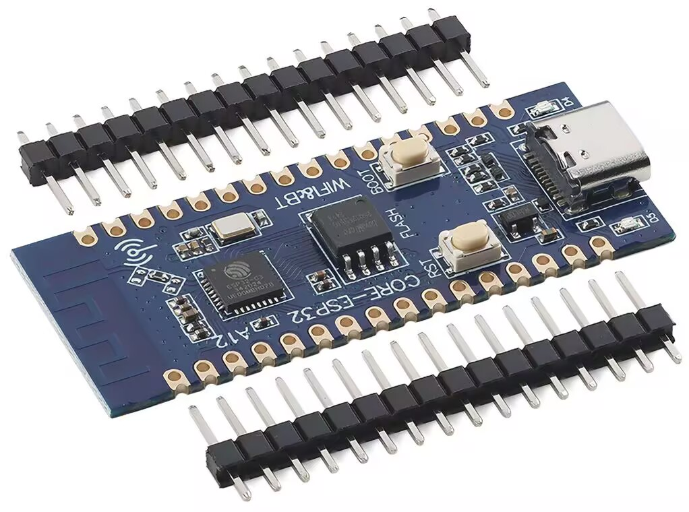
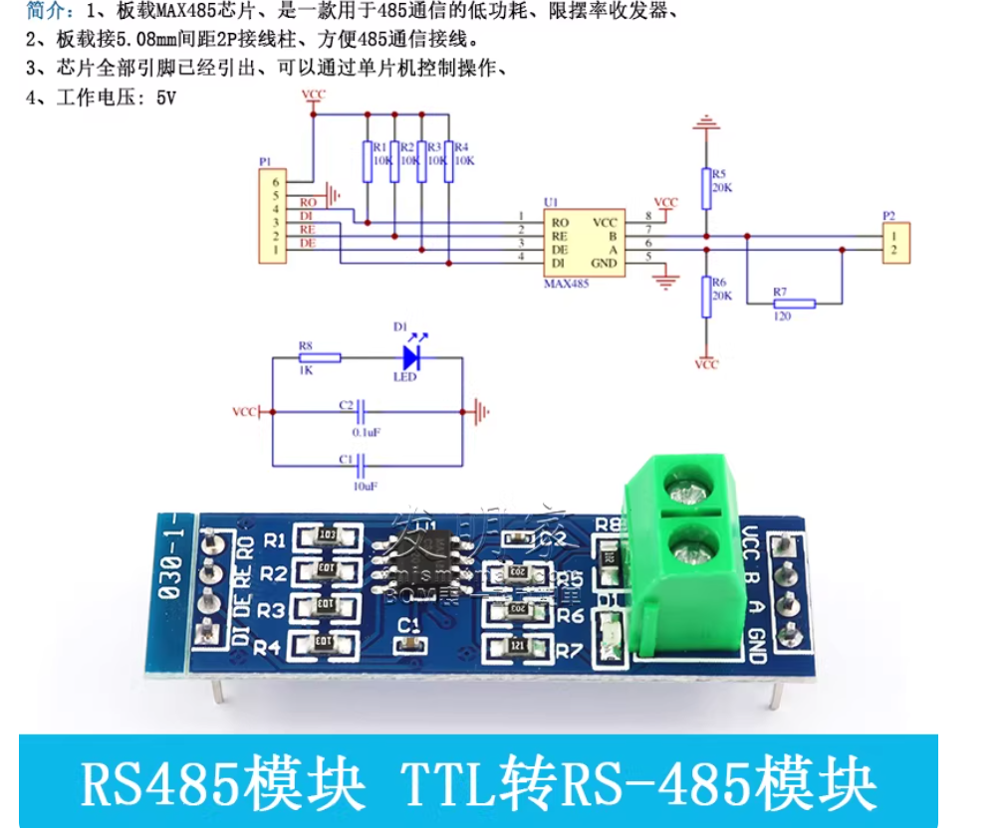
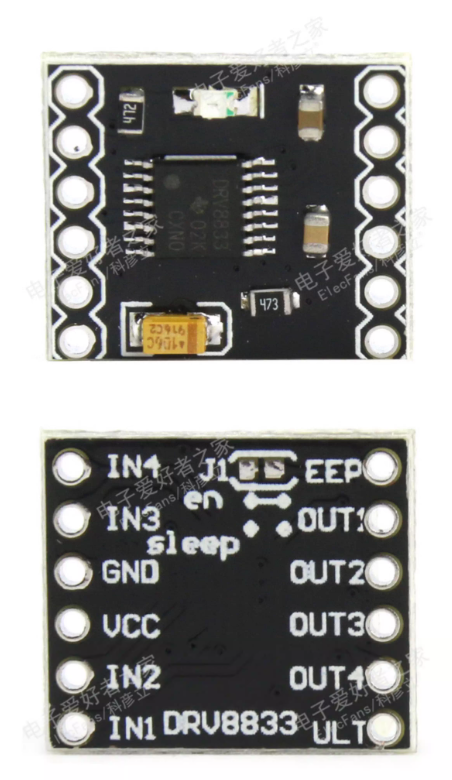
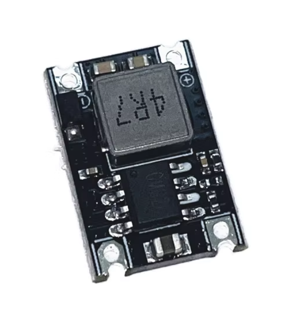

# 自动材料更换控制单元（团子 BMCU-ESP）

[交流群 1093447641 欢迎加入](https://qm.qq.com/q/hrK8NNwo6Y)

## 方案

### 最低成本（杜邦线计划）（无io扩展模块，4色（最低24元）或者8色）
*** 必须 ***
- esp32（合宙esp32c3）
- tt电机（1/48黑头单轴）
- ttl转485模块（TX和RX最好，有DE也可以用就是了）
- drv8833电机驱动（黑版最好）
- 杜邦线

--- 可选 ---
- pcb版（没有画，用杜邦线连接吧）
- 微动（三脚带柄13.5mm按键微动）
- 弹簧外径5*长度10*线径0.4
- M3*20沉头螺丝
- M3*5沉头螺丝
- AMS数据线（4pin公对公，原厂线序，不是延长线）
- MX3 2*2 弯针座

### 团子pcb板子（最大支持16色）
*** 必须 ***
- esp32（合宙esp32c3）
- tt电机（1/48黑头单轴）
- ttl转485模块（TX和RX最好，有DE也可以用就是了）
- drv8833电机驱动（黑版最好）
- 杜邦线

--- 可选 ---
- [嘉立创pcb版 https://oshwhub.com/tz_simple/project_vsifmgrt](https://oshwhub.com/tz_simple/project_vsifmgrt)
- 微动（三脚带柄13.5mm按键微动）
- PCF8575 (io扩展模块)
- AMS数据线（4pin公对公，原厂线序，不是延长线）
- MX3 2*2 弯针座
- 弹簧外径5*长度10*线径0.4
- M3*20沉头螺丝
- M3*5沉头螺丝

#### 多个 PCF8575 说明
0x20 (默认) 项目需要的其他三个按照下面进行配置就可以了

两个io模块以上需要修改 需要在背后进行短接 接法如下

| I2C 总线地址 | A2  | A1 | A0 |
|---|---|---|---|
| 0x20 不需要动默认就是 | GND | GND | GND | 
| 0x21 | GND | GND | VCC |
| 0x22 | GND | VCC | GND |
| 0x23 | GND | VCC | VCC |
| 0x24 | VCC | GND | GND |
| 0x25 | VCC | GND | VCC |
| 0x26 | VCC | VCC | GND |
| 0x27 | VCC | VCC | VCC |

## 烧录教程
1. 在 [Releases](https://github.com/tsimplez/bmcu-esp/releases) 处下载适合的esp32固件
2. 电脑使用typec连接好esp32
3. 打开 [在线烧录网站](https://web.esphome.io)
4. 点击连接 -> 左上角选择串行端口 -> 点击安装（在 准备首次使用 旁边） -> 选择下载好的固件安装就可以了
5. 最后连接esp32 的 wifi（BMCU_xxxxxx）访问 [192.168.4.1](http://192.168.4.1) 或 [http://bmcu.local](http://bmcu.local)

## BOM清单
也可以看这个清单 https://b.242499.xyz/bmcu
### 必须
| 品名 | 参考图  | 数量 | 说明 |
|---|---|---|---|
| esp32 |  | 1 | 简约 和 经典 都可以 | 
| RS485模块 TTL转RS485 |   | 1 | 两种都可以 |
| PCF8575 |  | 2 | 一个就是4色 两个就是8色 3个12色 4个16色 |
| DRV8833电机驱动 |  | 4 | 一个控制两个电机 |
| TT电机 1/48黑头单轴 |  | 8 | 白头应该也可以 几色就几个 |
| 压板弹簧外径5*长度10*线径0.4 |  | 8 | 无所谓，长了就剪 |
| M3沉头螺丝 |  | * | 推荐每个规格都买(平时也用的到) 一种的话推荐(M3*20 长了就剪) |

### 可选
| 品名 | 参考图  | 数量 | 说明 |
|---|---|---|---|
| 三脚带柄13.5mm按键微动 |  | 8 | 可以不要 功能(可自吸和耗材在线检测) 至少一个电机一个|
| AMS数据线（4pin公对公，原厂线序，不是延长线） |  | 1 | 杜邦线也不是不能用 打印机ams接口是(上左 B 上右 A 下左 GND 下右 24V)和485模块的关系是(A接A B接B) | 
| MX3 2*2 弯针座 |  | 1 | AMS数据线接口 |
| mini 5V电源模块 |  | 1 | 不用也可以 用手机数据线(type-c)接esp32 |
| 2.54排母，要4P 5P 6P 10P 16P 可以直接买一份1x40P的自己剪断 |  | * | 不要也可以 直接焊接到pcb上(不方便拆) 买2P和3P组合使用也可以|
| xh2.54直针插座|  | * | 一个电机一个 |
| 温湿度模块|  | * | 可选|

## 项目简介

团子 BMCU 是一套面向 3D 打印机的自动材料更换控制单元固件，实现了与 Bambu Lab 打印机的
BambuBus 通信协议，支持多通道耗材管理、电机控制、编码器模拟与微动开关检测

- **平台适配层**，同一套控制逻辑可在 RP2040 / ESP32-S3 / ESP32-C3 上编译运行
- **ESP32 网页管理**（配网、参数、手动进退料、日志、OTA）
- **日志总线**、**引脚配置**、**设置迁移**与 **OTA 发布工具**；

> 本固件基于社区逆向工程实现，与 Bambu Lab 官方无关，仅供学习研究，非官方支持版本

全io可配 支持多种挤出机 tt电机 n20电机 电磁离合 以及 370电机

非常欢迎大家来根据本项目做出独属于自己的 BMCU

### 扩展说明
- 单微动（实现自吸和耗材在线检测）
- 单霍尔（需要搭配 home assistant (不然没办法知道当前阶段是否在打印)）

需要把 离线 切换回 在线或者自动（功能使用电机堵转实现（打印机会退料在进料（只能直接离线）有概率提示堵转））

- 五通微动 辅助送料减轻打印机压力(原理 五通下压，触发微动开关，短暂启动电机)

[适配机械键盘按键轴体 模型地址 https://makerworld.com.cn/zh/models/1911184-huan-chong-wei-dong-gua-pei-ji-jie-jian-pan-an-jia](https://makerworld.com.cn/zh/models/1911184-huan-chong-wei-dong-gua-pei-ji-jie-jian-pan-an-jia)

[适配K12微动-21x6.4mm 模型地址 https://makerworld.com.cn/zh/models/1911156-huan-chong-wei-dong-gua-pei-k12wei-dong-21x6-4mm](https://makerworld.com.cn/zh/models/1911156-huan-chong-wei-dong-gua-pei-k12wei-dong-21x6-4mm)

## 支持的平台

| PlatformIO 环境 | 主控 | 说明 |
|---|---|---|
| `pico` | RP2040（Raspberry Pi Pico） | 默认环境设置存片内 Flash；BambuBus 走 UART0；无网页（Web 层为空实现）（考虑删除中） |
| `esp32s3` | ESP32-S3 | 16 MB Flash + OPI PSRAM，`default_16MB.csv` 分区；日志走 UART0（GPIO43/44） |
| `esp32c3` | ESP32-C3 | 4 MB Flash，`min_spiffs.csv` 分区（双 OTA 槽）；默认 4 通道直连 GPIO |
| `esp32c3_air` | 合宙 ESP32-C3 经典款 / 简约款 | 共用一个固件，同上分区与引脚方案；原生 USB 日志随 GPIO18/19 占用自动启停，板载 LED 在 GPIO12/13 |

平台差异集中在 `src/platform.h` / `src/platform.cpp`，其余文件保持平台无关

## 软件架构

### 目录结构

```
src/
├── main.cpp/h          # 程序入口：初始化各层并跑主循环
├── platform.cpp/h      # 平台适配层（HAL）：引脚映射、I2C、UART、看门狗、非易失存储
├── BMCU.cpp/h          # 自动材料更换控制核心（电机、微动、编码器模拟、AS5600）
├── BambuBus.cpp/h      # BambuBus 协议实现
├── Motor.cpp/h         # 电机驱动封装
├── io_config.cpp/h     # 电机/微动引脚配置：默认值、校验、可选引脚与标签
├── settings_storage.cpp/h  # 设置存储（当前格式、CRC32、默认值与加载）
├── project_presets.cpp/h   # 项目接线预设、校验、应用和当前配置匹配
├── log_bus.cpp/h        # 日志总线：两路环形缓冲 + 增量读取
├── web_config.cpp/h    # 网页管理（仅 ESP32，其它平台为空实现）
├── PCF8575_PinMap.cpp/h# PCF8575 GPIO 扩展
├── crc_bus.c/h         # BambuBus 收发 CRC8 / CRC16 查表校验（不依赖 lib/CRC）
└── version.h           # 固件版本与 OTA 板型键名（FW_VERSION / FW_TARGET）

web/index.html          # 管理页面，构建时 gzip 压缩后编入 ESP32 固件
web/manifest.webmanifest # 应用名称、图标和主屏幕启动方式
web/icons/              # 用户提供的团子图片压缩为 192/512/180 像素主屏幕 PNG 图标
web/sw.js、offline.html # 安全上下文的离线连接说明，不缓存设备控制台
scripts/prepare_web.py  # 打包网页与 PWA 资源，检查完整固件镜像的分区容量
```

### 主循环

```
setup():  日志/看门狗 → 加载设置 → 释放 USB 焊盘 → 按接线配置控制台 → GPIO/I2C → BMCU_init → web_config_init
loop():   喂狗 → BMCU_run（协议/总线） → 微动状态检查 → web_config_run（网页） → yield()
```

## 网页管理

仅 ESP32 平台生效，RP2040 为空实现（不影响编译）

- **主要接口**：

| 接口 | 方法 | 用途 |
|---|---|---|
| `/manifest.webmanifest`、`/sw.js`、`/offline.html`、`/icons/*` | GET | 构建时编入固件的应用清单、Service Worker、离线说明和图标 |
| `/api/status` | GET | 运行状态、通道与电机状态、耗材颜色与透明度、并发上限等；`mdns` 为配置名称，`mdns_active` 为实际名称（离线或待更新时为空） |
| `/api/ws-token` | GET | 获取本次启动的 WebSocket 连接凭据，沿用 HTTP 同源与 localhost 跨域限制，禁止缓存 |
| `/api/ws` | WebSocket，端口 81 | 订阅状态与霍尔增量历史，数据字段与对应 HTTP 接口一致 |
| `/api/settings` | GET / POST | 读取 / 保存通道参数 |
| `/api/home-assistant` | GET | 读取 HA 配置，包含连接代次 `generation` 和是否已选两个状态实体 `selected`；令牌只返回是否已配置 |
| `/api/home-assistant` | POST | 第一步保存连接，只提交 `enabled`、`url`、`token`；空令牌保留原值 |
| `/api/home-assistant/selection` | POST | 第二步保存 `stage_entity`、`status_entity` 和当前连接的 `generation` |
| `/api/home-assistant/entities` | GET | 按 `offset`、`generation` 异步读取实体候选；首次刷新附 `refresh=1`，按 `ready` 和 `next_offset` 逐页获取 |
| `/api/bus` | POST | 保存 BambuBus 接线与 RS485 模式，或双空 RX/TX 的局域网配对/换料参数，重启生效 |
| `/api/lan/channel` | POST | 已配对且空闲时确认当前装料通道，`channel` 为 0 基编号或 -1（未知），不启动电机 |
| `/api/lan/cancel` | POST | 提交停止局域网换料请求，由主循环停车并清除当前通道确认 |
| `/api/pcf` | POST | 保存 I2C 接线（SDA/SCL 同时有效才启用） |
| `/api/motor` | POST | 手动进退料（`motor` / `dir` / 可选 `duration`） |
| `/api/scan` | GET | 扫描 WiFi |
| `/api/wifi` / `/api/mdns` / `/api/forget` | POST | 保存 WiFi / 保存 mDNS 名称 / 清除 WiFi |
| `/api/log` | GET | 增量拉取日志（`dl=1` 下载附件） |
| `/api/hall` | GET | 霍尔当前值、短期均值与增量历史；通道的 `avg_1s` / `avg_5s` 为近 1 秒 / 5 秒有效样本平均 ADC 值，无有效样本返回 `null` |
| `/api/hall/detection` | POST | 保存单通道霍尔 ADC 上下限与无转动超时，字段和状态见霍尔停转检测说明 |
| `/api/ota/check` | POST / GET | POST 启动或加入后台版本检查，GET 携带 `id` 查询进度和结果，无需维护状态 |
| `/api/ota/pull` / `upload` | POST | 在线更新 / 本地上传，要求满足维护条件且没有正在执行的版本检查 |
| `/api/reboot` | GET | 重启 |
| `/api/factory` | POST | 恢复默认设置 |

## 编译与烧录

```bash
# 安装 PlatformIO 后
pio run                      # 编译（默认环境 esp32c3_air）
pio run -e esp32s3           # 指定环境
pio run -e esp32c3_air      # 经典款 / 简约款共用固件
pio run -e esp32c3 -t upload # 编译并上传
pio run -t clean             # 清理
```

## 有关于市面上的 bmcu 项目
工作方式说明
- 没离合的挤出机 打印中 电机必须启动（耗电，电机容易坏）
- 有离合的挤出机 可以在打印中 电机不启动,阻力会大一点。可以通过 五通微动 缓存 让打印中电机也启动，助力减小

功能说明
- 微动 进料的第一个微动（实现自吸和耗材在线检测） 第二个微动（实现最大退料距离）
- 霍尔
一般都是用来实现缓冲功能（可以减少对打印头的压力，打印机拉耗材更轻松）
也可以用来实现耗材空打和检测（本项目就是）

其他
- 【Top ams】和【天枢TTC DMS】相似 （模块思路 价格便宜 手动制作难度低（优化不用了,模块还可以拿来做其他的 比如 小车））
- 【孔明】和【怪兽】相似 （pcb贴片 价格贵 手动制作难度高）

[130电机和370区别 https://b23.tv/GiIful5](https://b23.tv/GiIful5)

n20电机声音比tt(130)电机小一点，所以力也小一点（不推荐）

### Ams Lite Mini 485
[教程 https://docs.qq.com/doc/DVm9tRkhkSXF1ZGZi](https://docs.qq.com/doc/DVm9tRkhkSXF1ZGZi)

### Top ams
之前使用此方案的，可以沿用上述局域网换料方式，或增加 TTL 转 RS485 模块后改用有线 BambuBus
- 功能: 微动 tt电机 n20电机 mqtt（局域网）方案（使用这个手机就不能发送模型打印了）
- 群: 882091399
- [教程 https://docs.qq.com/doc/DVkZIR0NtYUtsenB6](https://docs.qq.com/doc/DVkZIR0NtYUtsenB6)
- [仓库 https://github.com/nccrrv/Top-AMS](https://github.com/nccrrv/Top-AMS)
- [tt模型 https://makerworld.com.cn/models/1418429](https://makerworld.com.cn/models/1418429)

### 天枢TTC
之前使用此方案的，可以很方便迁移到本项目（只需要加 一个esp32 ）
- 功能: 微动 tt电机 n20电机
- 群: 981655616
- [教程 https://my.feishu.cn/wiki/N4bXwJpWUirYBFkMr81cw0umn72](https://my.feishu.cn/wiki/N4bXwJpWUirYBFkMr81cw0umn72)
- [仓库 https://github.com/hu504011383/Tianshu](https://github.com/hu504011383/Tianshu)
- [tt模型 https://makerworld.com.cn/models/1418429](https://makerworld.com.cn/models/1418429)
- [TTC模型 https://makerworld.com.cn/models/2226484](https://makerworld.com.cn/models/2226484)

### 孔明(主板使用ttl烧录)
- 功能: 霍尔 双微动 370电机
- 群 981889040
- [教程 https://b23.tv/zsuv8dt](https://b23.tv/zsuv8dt)

### 怪兽(比孔明的主板多了typec烧录(340芯片)(烧录更简单))
- 功能: 霍尔 双微动 370电机
- 群 1025731130
- [教程](https://b23.tv/F88rm5g)
- 26-10-17: 配件包价格 185(塑料)

### bmcu pro
- 功能: 霍尔 双微动 370电机 回卷
- 群 735647789
- [教程 https://www.yuque.com/yuqueyonghu-yxa2f7/uv47x9](https://www.yuque.com/yuqueyonghu-yxa2f7/uv47x9)

### NeMCU
- 功能: web页面 esp32 全霍尔 370电机
- 群 851019565
- [组装教程 https://www.bilibili.com/video/BV1mV4n6MELF](https://www.bilibili.com/video/BV1mV4n6MELF)
- [模型地址 https://makerworld.com.cn/zh/models/3193216](https://makerworld.com.cn/zh/models/3193216)

### ap-ams
- 功能: 打印机中齿轮不咬合，需要两个电机实现 tt电机
- 项目地址 https://github.com/applenana/AP-AMS
- [组装教程 https://b23.tv/9hSzVES](https://b23.tv/9hSzVES)
- [模型地址 https://makerworld.com.cn/models/166504](https://makerworld.com.cn/models/166504)

### 波兰固件
[仓库](https://github.com/jarczakpawel/BMCU-C-PJARCZAK)

#### 和 bmcu-esp(本项目) 的区别
本项目基于[Tianshu](https://github.com/hu504011383/Tianshu)
然后 Tianshu 似乎是基于 BMCU-C-PJARCZAK 的 V9 PJarczak 2026/2/24 07:04 修改而来
所以 本项目一样也是
不过 后续会同步一些相同的地方，文件上方有标记

https://github.com/RobTillaart/PCF8575

### 其他
#### 最新版本支持（第一次打印有效）
https://github.com/Le-Maxime/BMCU-U
https://github.com/jarczakpawel/BMCU-Flasher

欢迎补充内容

## 待处理
打印机退料 -> 5秒后打印机要求停止 -> 打印机进料
似乎和 AS5600_get_distance_E _filament meters 长度有关系
