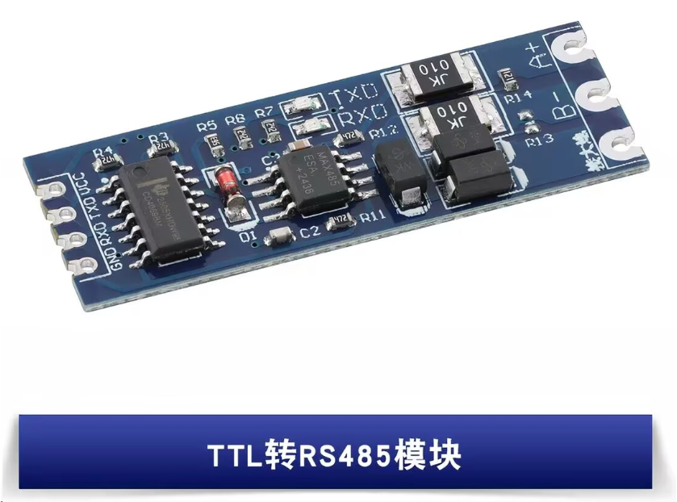
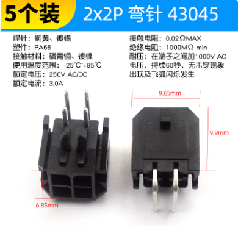
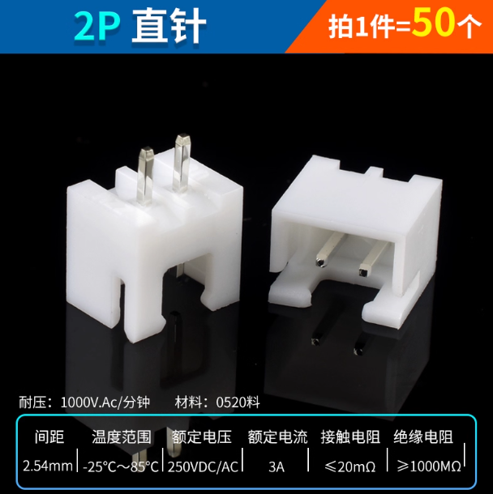

# 自动材料更换控制单元（团子 BMCU-ESP）

[交流群 1093447641 欢迎加入](https://qm.qq.com/q/hrK8NNwo6Y)

## 方案

### 最低成本（无io扩展模块，4色（最低24元）或者8色）
*** 必须 ***
- esp32（合宙esp32c3）
- tt电机（1/48黑头单轴）
- ttl转485模块（TX和RX最好，有DE也可以用就是了）
- drv8833电机驱动（黑版最好）
- 杜邦线

--- 可选 ---
- pcb版（没有画，用杜邦线连接吧）
- 微动（三脚带柄13.5mm按键微动）
- 弹簧外径5*长度10*线径0.4
- M3*20沉头螺丝
- M3*5沉头螺丝
- AMS数据线（4pin公对公，原厂线序，不是延长线）
- MX3 2*2 弯针座

### 团子pcb板子（最大支持16色）
*** 必须 ***
- esp32（合宙esp32c3）
- tt电机（1/48黑头单轴）
- ttl转485模块（TX和RX最好，有DE也可以用就是了）
- drv8833电机驱动（黑版最好）
- 杜邦线

--- 可选 ---
- [嘉立创pcb版 https://oshwhub.com/tz_simple/project_vsifmgrt](https://oshwhub.com/tz_simple/project_vsifmgrt)
- 微动（三脚带柄13.5mm按键微动）
- PCF8575 (io扩展模块)
- AMS数据线（4pin公对公，原厂线序，不是延长线）
- MX3 2*2 弯针座
- 弹簧外径5*长度10*线径0.4
- M3*20沉头螺丝
- M3*5沉头螺丝

#### 多个 PCF8575 说明
0x20 (默认) 项目需要的其他三个按照下面进行配置就可以了

| I2C 总线地址 | A2  | A1 | A0 |
|---|---|---|---|
| 0x20 | GND | GND | GND | 
| 0x21 | GND | GND | VCC |
| 0x22 | GND | VCC | GND |
| 0x23 | GND | VCC | VCC |
| 0x24 | VCC | GND | GND |
| 0x25 | VCC | GND | VCC |
| 0x26 | VCC | VCC | GND |
| 0x27 | VCC | VCC | VCC |

## 烧录教程
1. 在 [Releases](https://github.com/tsimplez/bmcu-esp/releases) 处下载适合的esp32固件
2. 电脑使用typec连接好esp32
3. 打开 [在线烧录网站](https://web.esphome.io)
4. 点击连接 -> 左上角选择串行端口 -> 点击安装（在 准备首次使用 旁边） -> 选择下载好的固件安装就可以了
5. 最后连接esp32 的 wifi（BMCU_xxxxxx）访问 [192.168.4.1](http://192.168.4.1) 或 [http://bmcu.local](http://bmcu.local)

## BOM清单
也可以看这个清单 https://b.242499.xyz/bmcu
### 必须
| 品名 | 参考图  | 数量 | 说明 |
|---|---|---|---|
| esp32 |  | 1 | 简约 和 经典 都可以 | 
| RS485模块 TTL转RS485 |   | 1 | 两种都可以 |
| PCF8575 |  | 2 | 一个就是4色 两个就是8色 3个12色 4个16色 |
| DRV8833电机驱动 |  | 4 | 一个控制两个电机 |
| TT电机 1/48黑头单轴 |  | 8 | 白头应该也可以 几色就几个 |
| 压板弹簧外径5*长度10*线径0.4 |  | 8 | 无所谓，长了就剪 |
| M3沉头螺丝 |  | * | 推荐每个规格都买(平时也用的到) 一种的话推荐(M3*20 长了就剪) |

### 可选
| 品名 | 参考图  | 数量 | 说明 |
|---|---|---|---|
| 三脚带柄13.5mm按键微动 |  | 8 | 可以不要 功能(可自吸和耗材在线检测) 至少一个电机一个|
| AMS数据线（4pin公对公，原厂线序，不是延长线） |  | 1 | 杜邦线也不是不能用 打印机ams接口是(上左 B 上右 A 下左 GND 下右 24V)和485模块的关系是(A接A B接B) | 
| MX3 2*2 弯针座 |  | 1 | AMS数据线接口 |
| mini 5V电源模块 |  | 1 | 不用也可以 用手机数据线(type-c)接esp32 |
| 2.54排母，要4P 5P 6P 10P 16P 可以直接买一份1x40P的自己剪断 |  | * | 不要也可以 直接焊接到pcb上(不方便拆) 买2P和3P组合使用也可以|
| xh2.54直针插座|  | * | 一个电机一个 |
| 温湿度模块|  | * | 可选|

## 项目简介

团子 BMCU 是一套面向 3D 打印机的自动材料更换控制单元固件，实现了与 Bambu Lab 打印机的
BambuBus 通信协议，支持多通道耗材管理、电机控制、编码器模拟与微动开关检测

- **平台适配层**，同一套控制逻辑可在 RP2040 / ESP32-S3 / ESP32-C3 上编译运行
- **ESP32 网页管理**（配网、参数、手动进退料、日志、OTA）
- **日志总线**、**引脚配置**、**设置迁移**与 **OTA 发布工具**；

> 本固件基于社区逆向工程实现，与 Bambu Lab 官方无关，仅供学习研究，非官方支持版本

### 扩展说明
- 单微动（实现自吸和耗材在线检测）
- 单霍尔（需要搭配 home assistant (不然没办法知道当前阶段是否在打印)）

需要把 离线 切换回 在线或者自动（功能使用电机堵转实现（打印机会退料在进料（只能直接离线）有概率提示堵转））

- 五通微动 辅助送料减轻打印机压力(原理 五通下压，触发微动开关，短暂启动电机)

[适配机械键盘按键轴体 模型地址 https://makerworld.com.cn/zh/models/1911184-huan-chong-wei-dong-gua-pei-ji-jie-jian-pan-an-jia](https://makerworld.com.cn/zh/models/1911184-huan-chong-wei-dong-gua-pei-ji-jie-jian-pan-an-jia)

[适配K12微动-21x6.4mm 模型地址 https://makerworld.com.cn/zh/models/1911156-huan-chong-wei-dong-gua-pei-k12wei-dong-21x6-4mm](https://makerworld.com.cn/zh/models/1911156-huan-chong-wei-dong-gua-pei-k12wei-dong-21x6-4mm)

## 支持的平台

| PlatformIO 环境 | 主控 | 说明 |
|---|---|---|
| `pico` | RP2040（Raspberry Pi Pico） | 默认环境设置存片内 Flash；BambuBus 走 UART0；无网页（Web 层为空实现）（考虑删除中） |
| `esp32s3` | ESP32-S3 | 16 MB Flash + OPI PSRAM，`default_16MB.csv` 分区；日志走 UART0（GPIO43/44） |
| `esp32c3` | ESP32-C3 | 4 MB Flash，`min_spiffs.csv` 分区（双 OTA 槽）；默认 4 通道直连 GPIO |
| `esp32c3_air` | 合宙 ESP32-C3 经典款 / 简约款 | 共用一个固件，同上分区与引脚方案；原生 USB 日志随 GPIO18/19 占用自动启停，板载 LED 在 GPIO12/13 |

平台差异集中在 `src/platform.h` / `src/platform.cpp`，其余文件保持平台无关

## 主要特性

- **多通道材料管理**：AMS 数量 1–4，每个 AMS 对应 4 个通道（最多 16 路）；未接线（引脚为「无」）的通道不可启动电机
- **BambuBus 通信**：与打印机交互，支持 RS485 两种收发方式；可选原始报文日志
- **电机控制**：进料 / 退料 / 停止，支持同时运行电机数上限与排队，超时自动停车；打印机进料结束后的停止延迟可在网页自定义
- **微动开关检测**：自动模式按微动状态更新通道；微动辅助进料（时长可配，0=关闭）
- **49E 霍尔与通道卡片**：每通道可配置主控 ADC 输入，网页显示当前使用通道、原始读数、近 1 秒与近 5 秒平均值及最近一分钟的曲线；短期平均值按窗口内完整 200 ms 桶的有效样本数加权，不足窗口时使用已有样本，无样本显示「—」，每秒刷新；接线数量受主控 ADC 资源限制
- **AS5600 编码器模拟**：模拟磁编码器，返回角度、磁场状态与速度
- **引脚可配置**：电机、通道微动、五通总微动与霍尔引脚由 `io_config` 管理，可在网页里选择与校验；配置 I2C 后微动可选择 PCF8575 扩展输入，霍尔只允许主控 ADC
- **设置存储**：使用魔数 + CRC32 校验，写入由存储后端保障（RP2040 片内 Flash / ESP32 NVS）
- **日志总线**：主板日志与 BambuBus 报文两路环形缓冲，网页按游标增量拉取，写入不阻塞
- **网页管理 / OTA**：ESP32 平台提供配网热点、管理页面与在线/本地固件升级
- **看门狗**：防止程序卡死（10 秒任务看门狗）
- **逐台 AMS 身份**：完整序列号固定为 `0EA + AMS 编号（0..3）+ 12 位后缀`；网页 AMS 1～4 各自设置后缀和版本，并显示实际完整序列号。后缀留空时取芯片 ID 的低 48 位，再把最后一位替换为 AMS 编号；自定义后缀原样保留
- **身份保持**：四份配置独立保存，减少 AMS 数量不会清除停用台的身份；只有实际序列号变化的 AMS 重新报名。AMS 版本默认均为 `1.0.6.87`，可以逐台设置为相同或不同版本
- 打印机可能缓存旧身份；修改后若仍显示旧序列号或不能重新注册，需要让打印机重新枚举连接。网页“实际完整序列号”显示固件当前使用的值，不代表打印机缓存已刷新

## 软件架构

### 目录结构

```
src/
├── main.cpp/h          # 程序入口：初始化各层并跑主循环
├── platform.cpp/h      # 平台适配层（HAL）：引脚映射、I2C、UART、看门狗、非易失存储
├── BMCU.cpp/h          # 自动材料更换控制核心（电机、微动、编码器模拟、AS5600）
├── BambuBus.cpp/h      # BambuBus 协议实现
├── Motor.cpp/h         # 电机驱动封装
├── io_config.cpp/h     # 电机/微动引脚配置：默认值、校验、可选引脚与标签
├── settings_storage.cpp/h  # 设置存储（当前格式、CRC32、默认值与加载）
├── project_presets.cpp/h   # 项目接线预设、校验、应用和当前配置匹配
├── log_bus.cpp/h        # 日志总线：两路环形缓冲 + 增量读取
├── web_config.cpp/h    # 网页管理（仅 ESP32，其它平台为空实现）
├── PCF8575_PinMap.cpp/h# PCF8575 GPIO 扩展
├── crc_bus.c/h         # BambuBus 收发 CRC8 / CRC16 查表校验（不依赖 lib/CRC）
└── version.h           # 固件版本与 OTA 板型键名（FW_VERSION / FW_TARGET）

web/index.html          # 管理页面，构建时 gzip 压缩后编入 ESP32 固件
scripts/prepare_web.py  # 生成压缩网页头文件，检查完整固件镜像的分区容量
```

### 主循环

```
setup():  日志/看门狗 → 加载设置 → 释放 USB 焊盘 → 按接线配置控制台 → GPIO/I2C → BMCU_init → web_config_init
loop():   喂狗 → BMCU_run（协议/总线） → 微动状态检查 → web_config_run（网页） → yield()
```

## 网页管理

仅 ESP32 平台生效，RP2040 为空实现（不影响编译）

- **访问方式**：上电连不上已保存 WiFi 时开启配网热点（SSID `BMCU_<芯片ID后6位>`，密码 `12345678`），浏览器自动弹出配网页；
  联网后访问 `http://<设备IP>/` 或 `http://<mDNS名称>.local/`（默认 `bmcu`，可在配网页自定义）；同一局域网重名时自动使用 `bmcu-2`、`bmcu-3` 等编号，实际地址见配网页「当前访问地址」或日志
  自动编号不覆盖保存的名称，重启后重新检测重名；自定义名称同样适用，若名称已有 `-数字` 后缀则递增该数字；热点密码与 HTTP 接口为固定/无认证，见「已知限制」
- **本地预览**：通过 `http://localhost:63343/bmcu-esp/web/index.html` 等 localhost 地址打开时，API 请求自动转到 `http://192.168.2.236`；换设备时修改 `web/index.html` 脚本开头的 `LOCAL_API_BASE`，直接访问设备 IP 或 mDNS 地址时使用当前设备
  固件仅对 HTTP localhost 来源开放 API 跨域读取和预检，支持任意本地端口及日志响应头；旧固件需先更新到包含此跨域处理的版本，才能从本地页面读取数据
- **自动重连**：已保存 WiFi 连接超过 15 秒仍未成功时开启配网热点，每次失败后等待 30 秒再尝试，重试期间保持热点和配网页可用；连上后自动关闭热点并恢复局域网访问，无需重启
  运行中掉线也会自动重连，超时后采用同样的配网与重试流程；未配置或已忘记网络时只开启配网热点
- **页面分页**：状态、配网、设置、固件更新、日志
- **数据连接**：项目配置旁可切换 WebSocket / HTTP 轮询，默认 WebSocket，按设备在当前浏览器记住选择，立即生效；两种方式均每秒更新状态，霍尔仅在可见状态页更新
  WebSocket 使用设备的 `81` 端口，localhost 预览沿用 `LOCAL_API_BASE` 的主机；断线后退避重连，页面标记数据过期，也可手动切回 HTTP 轮询；检查更新在后台执行，状态、霍尔和日志继续刷新，只有实际安装固件期间暂停，结束后恢复
- **主要接口**：

| 接口 | 方法 | 用途 |
|---|---|---|
| `/api/status` | GET | 运行状态、通道与电机状态、耗材颜色与透明度、并发上限等；`mdns` 为配置名称，`mdns_active` 为实际名称（离线或待更新时为空） |
| `/api/ws-token` | GET | 获取本次启动的 WebSocket 连接凭据，沿用 HTTP 同源与 localhost 跨域限制，禁止缓存 |
| `/api/ws` | WebSocket，端口 81 | 订阅状态与霍尔增量历史，数据字段与对应 HTTP 接口一致 |
| `/api/settings` | GET / POST | 读取 / 保存通道参数 |
| `/api/home-assistant` | GET | 读取 HA 配置，包含连接代次 `generation` 和是否已选两个状态实体 `selected`；令牌只返回是否已配置 |
| `/api/home-assistant` | POST | 第一步保存连接，只提交 `enabled`、`url`、`token`；空令牌保留原值 |
| `/api/home-assistant/selection` | POST | 第二步保存 `stage_entity`、`status_entity` 和当前连接的 `generation` |
| `/api/home-assistant/entities` | GET | 按 `offset`、`generation` 异步读取实体候选；首次刷新附 `refresh=1`，按 `ready` 和 `next_offset` 逐页获取 |
| `/api/bus` | POST | 保存 BambuBus 接线与 RS485 模式，或双空 RX/TX 的局域网配对/换料参数，重启生效 |
| `/api/lan/channel` | POST | 已配对且空闲时确认当前装料通道，`channel` 为 0 基编号或 -1（未知），不启动电机 |
| `/api/lan/cancel` | POST | 提交停止局域网换料请求，由主循环停车并清除当前通道确认 |
| `/api/pcf` | POST | 保存 I2C 接线（SDA/SCL 同时有效才启用） |
| `/api/motor` | POST | 手动进退料（`motor` / `dir` / 可选 `duration`） |
| `/api/scan` | GET | 扫描 WiFi |
| `/api/wifi` / `/api/mdns` / `/api/forget` | POST | 保存 WiFi / 保存 mDNS 名称 / 清除 WiFi |
| `/api/log` | GET | 增量拉取日志（`dl=1` 下载附件） |
| `/api/hall` | GET | 霍尔当前值、短期均值与增量历史；通道的 `avg_1s` / `avg_5s` 为近 1 秒 / 5 秒有效样本平均 ADC 值，无有效样本返回 `null` |
| `/api/hall/detection` | POST | 保存单通道霍尔 ADC 上下限与无转动超时，字段和状态见霍尔停转检测说明 |
| `/api/ota/check` | POST / GET | POST 启动或加入后台版本检查，GET 携带 `id` 查询进度和结果，无需维护状态 |
| `/api/ota/pull` / `upload` | POST | 在线更新 / 本地上传，要求满足维护条件且没有正在执行的版本检查 |
| `/api/reboot` | GET | 重启 |
| `/api/factory` | POST | 恢复默认设置 |

版本检查返回 `id`、`running`、`progress` 和 `result`；`running=false` 后读取 `result.ok` 及版本信息或错误说明，GET 的任务 ID 失效时返回 409。关闭自动提示时 POST 返回 `skipped=true`，手动检查使用 `force=1` 绕过此开关

日志发送缓冲按请求分配，版本检查期间缩小发送分块，为 TLS 握手保留内存；两路日志继续按原游标读取，缓冲分配失败时返回 503，客户端稍后重试

WebSocket 使用 JSON 文本消息，支持最多 4 个客户端，网络任务收发，主循环只读取运行缓存并生成数据

- 每次连接前读取 `/api/ws-token`，首帧发送 `{"type":"hello","token":"取得的凭据"}`，随后订阅；凭据只在本次启动有效，不写入浏览器存储或设备设置
- `{"type":"status","id":1}` 订阅或立即刷新状态，推送为 `{"type":"status","id":1,"elapsed_ms":0,"seq":1,"data":{...}}`；`elapsed_ms` 是从本次订阅被主循环处理到生成状态的毫秒差，用于保留电机操作后的状态时序
- `{"type":"hall","id":2,"epoch":1,"cursor":10}` 订阅霍尔，首次可省略 `epoch` 和 `cursor`；推送为 `{"type":"hall","id":2,"seq":2,"data":{...}}`，沿用 `epoch/cursor/reset/more` 自动分批补齐历史，`{"type":"hall","id":0}` 取消订阅
- 客户端收到推送后回复 `{"type":"ack","seq":1}`；每个客户端最多一帧等待确认，超时断开，避免慢连接积压；订阅 `id` 用正的 32 位无符号整数，客户端忽略旧 `id` 的数据

- 手动进退料按启用通道及电机接线显示；每次点动默认 300 ms，请求先排队，由主循环在并发上限内启动并计时
- 有线打印机进料期间点击「停止」（排队时为「取消排队」），主循环停止该通道电机、移除排队动作并清除电机运行及延迟停车计时，保留打印机协议动作状态和回复字段，总线继续正常收发
  该通道的重复进料请求保持停止；先收到针对该通道的有效非进料动作，再收到新的进料请求，才允许打印机重新进料。普通轮询、未知报文、其他通道请求和通信恢复均不会解除限制，手动进退料点动仍可使用且不会被重复进料请求接管
  恢复条件仅保存在本次启动的内存中；局域网换料期间点击「停止」沿用取消整个换料会话的行为
- 变更项（通道状态、退料时间、微动辅助时间、手动时长、进料停止延迟、并发上限等）保存后写入 Flash
- 每张通道卡片的标题后显示耗材颜色圆点，深色边框与浅色外环使黑白色也能辨认；悬停显示颜色值。`GET /api/status` 的 `filament_colors` 按从 0 开始的全局通道顺序返回 `#RRGGBB` 数组，长度为当前启用通道数，圆点按 RGB 实色显示。颜色来自固件耗材记录，可能是打印机下发值、已保存值或默认值；字段缺失或无效时显示空心圆并提示“颜色未知”，连接中断或状态过期时保留最近颜色并提示“上次读取”
- 圆点旁显示透明度百分比，0% 表示不透明，100% 表示完全透明；`GET /api/status` 的 `filament_alpha` 按与颜色相同的通道顺序返回 0–255 的 A 分量，网页按 `round((255-A)*100/255)` 换算。透明度缺失或无效时显示“透明度 —”并提示“透明度未知”；连接中断或状态过期时保留最近百分比并提示“上次读取”
- 「状态 → 通道参数与手动进退料」可填写进料停止延迟；「设置 → 电机、微动与霍尔引脚」在五通总微动旁实时显示“已压下 / 未压下”，未配置、输入不可用或设备断连时另行提示
- 五通总微动可选择 LOW / HIGH 压下电平（默认 LOW），每次进料时长可设为 1～29999 毫秒（默认 200），与通道接线一起保存；从未压下变为已压下时，让当前选中、有料且空闲的通道进料，持续压住不重复触发，五通时长独立于通道自吸设置。改线、切换电平或扩展器重连后的首次读数只建立基线，扩展器离线时不触发；采样和电机操作均由主循环执行
- `/api/settings` 的 `total_switch_active_level` 为 0（LOW）或 1（HIGH），`total_switch_feed_ms` 为 1～29999 的整数；HTTP / WebSocket 状态的 `total_switch` 返回当前 `pin`、`active_level` 和 `pressed`（1=已压下，0=未压下，-1=输入不可用或等待采样），电机来源 `source=5` 表示五通总微动
- 本次设置记录新增五通参数，仅接受当前格式和 CRC；旧格式记录在升级后恢复整份默认设置，不做迁移，升级前请记录现有接线和参数

## 编译与烧录

```bash
# 安装 PlatformIO 后
pio run                      # 编译（默认环境 esp32c3_air）
pio run -e esp32s3           # 指定环境
pio run -e esp32c3_air      # 经典款 / 简约款共用固件
pio run -e esp32c3 -t upload # 编译并上传
pio run -t clean             # 清理
```

- 公共依赖在 `[env]` 中声明（PCF8575），ESP32 构建时由 `scripts/prepare_web.py` 将 `web/index.html` 压缩为 gzip 并编入固件，浏览器自动解压；生成头文件放在各环境的构建目录，无需手动维护或单独烧录文件系统
- 构建完成和烧录前均检查完整 `firmware.bin` 大小，超过应用分区则报错，避免段对齐等开销未计入构建摘要而导致烧录后无法启动
- `pico` 环境需 `lib_ignore` 忽略 ESP32 专用库（WiFi/DNSServer/ESPmDNS/WebServer/Preferences）；`upload_protocol = picotool`
- C3 的 GPIO20/21 可分配给接线；启用通道、五通总微动、有线 BambuBus 或已配置 I2C 占用任一脚时，自动关闭 UART0 应用/SDK 日志，网页主板日志保留；接线应用后两脚均空闲时恢复 UART0 控制台
- C3 启动时先暂停 UART0 输出，`esp32c3_air` 同时停用原生 USB，读取接线后决定是否开启；运行中改线由主循环先释放旧引脚，再切换控制台并绑定新引脚，此运行期控制不改变 ROM/Bootloader 启动输出
- `esp32c3_air` 使用 `BMCU_USB_CDC_AUTO=1` 和 `ARDUINO_USB_CDC_ON_BOOT=0`，经典款与简约款无需选择板型；GPIO18/19 任一脚被启用通道、五通总微动、有线 BambuBus 或已配置 I2C 占用时，关闭原生 USB 日志并释放两脚，两脚空闲时恢复，USB 未连接或发送缓冲已满时跳过回显，不阻塞主循环
- `top-ams` 预设可使用 GPIO18/19 和 GPIO20/21，此时原生 USB 与 UART0 控制台均关闭，主板日志仍可在网页查看
- 其他 C3 环境的原生 USB 控制台由 `ARDUINO_USB_CDC_ON_BOOT` 控制：设为 `1` 时日志走原生 USB 并保留 GPIO18/19；未定义或设为 `0` 时使用 UART0 控制台，并释放 GPIO18/19 为普通 GPIO
- 发布工作流生成 `esp32s3-版本.bin`、`esp32c3-版本.bin`、`esp32c3_air-版本.bin` 和 `manifest.json`，经典款与简约款只需下载同一个 `esp32c3_air` 文件；OTA 清单只使用这三个环境的键名

## 有关于市面上的 bmcu 项目
- Top ams 和 天枢TTC 相似
- 孔明 和 怪兽 相似

### Ams Lite Mini 485
[教程 https://docs.qq.com/doc/DVm9tRkhkSXF1ZGZi](https://docs.qq.com/doc/DVm9tRkhkSXF1ZGZi)

### Top ams
之前使用此方案的，可以沿用上述局域网换料方式，或增加 TTL 转 RS485 模块后改用有线 BambuBus
- 功能: 微动
- 群: 882091399
- [教程 https://docs.qq.com/doc/DVkZIR0NtYUtsenB6](https://docs.qq.com/doc/DVkZIR0NtYUtsenB6)
- [仓库 https://github.com/nccrrv/Top-AMS](https://github.com/nccrrv/Top-AMS)
- [tt模型 https://makerworld.com.cn/models/1418429](https://makerworld.com.cn/models/1418429)

### 天枢TTC
之前使用此方案的，可以很方便迁移到本项目（只需要加 一个esp32 ）
- 功能: 微动
- 群: 981655616
- [教程 https://my.feishu.cn/wiki/N4bXwJpWUirYBFkMr81cw0umn72](https://my.feishu.cn/wiki/N4bXwJpWUirYBFkMr81cw0umn72)
- [仓库 https://github.com/hu504011383/Tianshu](https://github.com/hu504011383/Tianshu)
- [tt模型 https://makerworld.com.cn/models/1418429](https://makerworld.com.cn/models/1418429)
- [TTC模型 https://makerworld.com.cn/models/2226484](https://makerworld.com.cn/models/2226484)

### 孔明(主板使用ttl烧录)
- 功能: 霍尔 + 双微动 + 370电机
- 群 981889040
- [教程 https://b23.tv/zsuv8dt](https://b23.tv/zsuv8dt)

### 怪兽(比孔明的主板多了typec烧录(340芯片)(烧录更简单))
- 功能: 霍尔 + 双微动 + 370电机
- 群 1025731130
- [教程](https://b23.tv/F88rm5g)
- 26-10-17: 配件包价格 185(塑料)

### bmcu pro
- 功能: 霍尔 + 双微动 + 370电机 + 回卷
- 群 735647789
- [教程 https://www.yuque.com/yuqueyonghu-yxa2f7/uv47x9](https://www.yuque.com/yuqueyonghu-yxa2f7/uv47x9)

### NeMCU
- 功能: esp32 + 全霍尔 + 370电机
- 群 851019565

### 波兰固件
[仓库](https://github.com/jarczakpawel/BMCU-C-PJARCZAK)

#### 和 bmcu-esp(本项目) 的区别
本项目基于[Tianshu](https://github.com/hu504011383/Tianshu)
然后 Tianshu 似乎是基于 BMCU-C-PJARCZAK 的 V9 PJarczak 2026/2/24 07:04 修改而来
所以 本项目一样也是
不过 后续会同步一些相同的地方，文件上方有标记

https://github.com/RobTillaart/PCF8575

### 其他
#### 最新版本支持（第一次打印有效）
https://github.com/Le-Maxime/BMCU-U
https://github.com/jarczakpawel/BMCU-Flasher

欢迎补充内容

## 待处理
打印机退料 -> 5秒后打印机要求停止 -> 打印机进料
似乎和 AS5600_get_distance_E _filament meters 长度有关系

好像要是AMS_COUNT要是4个就得输入4个序列号了吧，不然都是一样的
