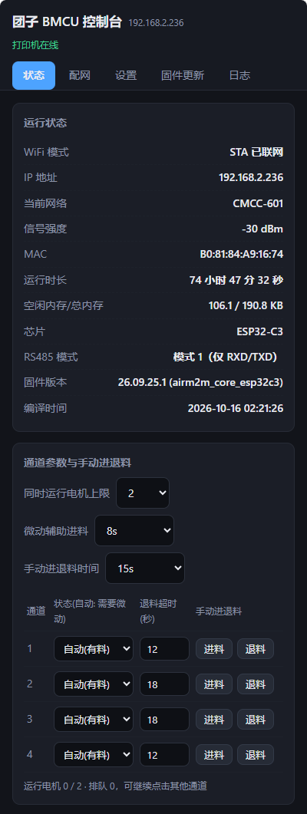
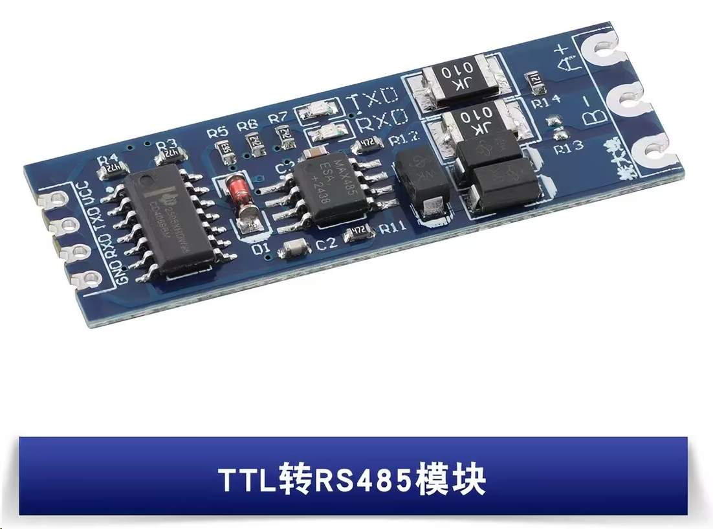

# 自动材料更换控制单元（BMCU-ESP）

[交流群 1093447641 欢迎加入](https://qm.qq.com/q/hrK8NNwo6Y)

## 有关于市面上的 bmcu 项目
- Top ams 和 天枢TTC 相似
- 孔明 和 怪兽 相似

### Top ams
- ***不推荐使用的是(mqtt方案)，其他项目都是使用485方案(和打印机直接通信)***
- 功能: 微动
- 群: 882091399
- [教程 https://docs.qq.com/doc/DVkZIR0NtYUtsenB6](https://docs.qq.com/doc/DVkZIR0NtYUtsenB6)
- [仓库 https://github.com/nccrrv/Top-AMS](https://github.com/nccrrv/Top-AMS)
- [tt模型 https://makerworld.com.cn/models/1418429](https://makerworld.com.cn/models/1418429)

### 天枢TTC
- 功能: 微动
- 群: 981655616
- [教程 https://my.feishu.cn/wiki/N4bXwJpWUirYBFkMr81cw0umn72](https://my.feishu.cn/wiki/N4bXwJpWUirYBFkMr81cw0umn72)
- [仓库 https://github.com/hu504011383/Tianshu](https://github.com/hu504011383/Tianshu)
- [tt模型 https://makerworld.com.cn/models/1418429](https://makerworld.com.cn/models/1418429)
- [TTC模型 https://makerworld.com.cn/models/2226484](https://makerworld.com.cn/models/2226484)

### 孔明(主板使用ttl烧录)
- 功能: 霍尔 + 双微动 + 370电机
- 群 981889040
- [教程 https://b23.tv/zsuv8dt](https://b23.tv/zsuv8dt)

### 怪兽(比孔明的主板多了typec烧录(340芯片)(烧录更简单))
- 功能: 霍尔 + 双微动 + 370电机
- 群 1025731130
- [教程](https://b23.tv/F88rm5g)
- 26-10-17: 配件包价格 185(塑料)

### bmcu pro
- 功能: 霍尔 + 双微动 + 370电机 + 回卷
- 群 735647789
- [教程 https://www.yuque.com/yuqueyonghu-yxa2f7/uv47x9](https://www.yuque.com/yuqueyonghu-yxa2f7/uv47x9)

### 其他
欢迎补充内容

## 项目简介

团子 BMCU 是一套面向 3D 打印机的自动材料更换控制单元固件，实现了与 Bambu Lab 打印机的
BambuBus 通信协议，支持多通道耗材管理、电机控制、编码器模拟与微动开关检测

- **平台适配层**，同一套控制逻辑可在 RP2040 / ESP32-S3 / ESP32-C3 上编译运行
- **ESP32 网页管理**（配网、参数、手动进退料、日志、OTA）
- **日志总线**、**引脚配置**、**设置迁移**与 **OTA 发布工具**；



> 本固件基于社区逆向工程实现，与 Bambu Lab 官方无关，仅供学习研究，非官方支持版本

## 支持的平台

| PlatformIO 环境 | 主控 | 说明 |
|---|---|---|
| `pico` | RP2040（Raspberry Pi Pico） | 默认环境设置存片内 Flash；BambuBus 走 UART0；无网页（Web 层为空实现） |
| `esp32s3` | ESP32-S3 | 16 MB Flash + OPI PSRAM，`default_16MB.csv` 分区；日志走 UART0（GPIO43/44） |
| `esp32c3` | ESP32-C3 | 4 MB Flash，`min_spiffs.csv` 分区（双 OTA 槽）；默认 4 通道直连 GPIO |
| `airm2m_core_esp32c3` | 合宙 AirM2M CORE ESP32-C3 | 同上分区与引脚方案，板载 LED 在 GPIO12/13 |

平台差异集中在 `src/platform.h` / `src/platform.cpp`，其余文件保持平台无关

## 主要特性

- **多通道材料管理**：AMS 数量 1–4，每个 AMS 对应 4 个通道（最多 16 路）；未接线（引脚为「无」）的通道不可启动电机
- **BambuBus 通信**：与打印机交互，支持 RS485 两种收发方式；可选原始报文日志
- **电机控制**：进料 / 退料 / 停止，支持同时运行电机数上限与排队，超时自动停车
- **微动开关检测**：自动模式按微动状态更新通道；微动辅助进料（时长可配，0=关闭）
- **AS5600 编码器模拟**：模拟磁编码器，返回角度、磁场状态与速度
- **引脚可配置**：电机与微动引脚由 `io_config` 管理，可在网页里选择与校验；PCF8575 扩展作为可选开关
- **设置存储**：使用魔数 + CRC32 校验，写入由存储后端保障（RP2040 片内 Flash / ESP32 NVS）
- **日志总线**：主板日志与 BambuBus 报文两路环形缓冲，网页按游标增量拉取，写入不阻塞
- **网页管理 / OTA**：ESP32 平台提供配网热点、管理页面与在线/本地固件升级
- **看门狗**：防止程序卡死（10 秒任务看门狗）
- **自定义序列号**：可指定 15 位序列号，留空则按芯片 ID 自动生成

## 硬件要求

- 主控：Raspberry Pi Pico / ESP32-S3 / ESP32-C3（合宙 AirM2M CORE ESP32-C3）
- 通信：UART + RS485 收发模块（BambuBus）、可选 PCF8575（I2C）
- 电机驱动：DRV8833 等（每通道两个方向脚）
- 检测：微动开关（材料在线检测）



## 软件架构

### 目录结构

```
src/
├── main.cpp/h          # 程序入口：初始化各层并跑主循环
├── platform.cpp/h      # 平台适配层（HAL）：引脚映射、I2C、UART、看门狗、非易失存储
├── BMCU.cpp/h          # 自动材料更换控制核心（电机、微动、编码器模拟、AS5600）
├── BambuBus.cpp/h      # BambuBus 协议实现
├── Motor.cpp/h         # 电机驱动封装
├── io_config.cpp/h     # 电机/微动引脚配置：默认值、校验、可选引脚与标签
├── settings_storage.cpp/h  # 设置存储（V6 格式、CRC32、默认值与迁移）
├── logbus.cpp/h        # 日志总线：两路环形缓冲 + 增量读取
├── web_config.cpp/h    # 网页管理（仅 ESP32，其它平台为空实现）
├── PCF8575_PinMap.cpp/h# PCF8575 GPIO 扩展
├── FIFO_buffer.c/h     # 环形缓冲区
├── crc_bus.c/h         # CRC8 / CRC16 校验
├── time64.cpp/h        # 64 位时间工具
└── version.h           # 固件版本与 OTA 板型键名（FW_VERSION / FW_TARGET）

web/index.html          # 管理页面，构建时作为二进制块编入固件
tools/
├── make_ota.py         # 生成 OTA 发布目录与 manifest.json
├── OTA_SERVER.md       # OTA 服务器与发布流程说明
└── test_web_config.cjs # 网页内联脚本语法检查
```

### 主循环

```
setup():  控制台/看门狗/日志 → 加载设置 → 释放 USB 焊盘 → I2C → BMCU_init → web_config_init
loop():   喂狗 → BMCU_run（协议/总线） → 微动状态检查 → web_config_run（网页） → yield()
```

### 平台适配层（`platform.h` / `platform.cpp`）

- 引脚映射：按 `CONFIG_IDF_TARGET_ESP32C3` / `ARDUINO_ARCH_ESP32` / RP2040 分组，未使用的通道用 `PIN_NONE(255)` 占位
- 非易失存储：ESP32 用 NVS（命名空间 `settings` / `filament`），RP2040 用片内 Flash 固定偏移，接口统一为 `hal_storage_read/write`
- 总线串口：ESP32 用 `Serial1`（事件回调，RX 缓冲 2048），RP2040 用 `uart0`（中断），均为 8E1
- 看门狗、I2C、控制台串口均在此层实现

### 设置存储（`settings_storage`）

- 运行期设置包括：退料超时、通道模式、AMS 数量、手动点动时长、微动辅助进料时长、电机并发上限、RS485 模式、报文日志开关、序列号、OTA 源与提示开关、IO 引脚配置、PCF8575 开关与 I2C 接线、总线接线
- 记录带魔数（`0x53415429`）与 CRC32；校验失败即恢复默认值
- 保存失败时用内存快照回退，避免读到不完整 Flash
- 启动与保存后都会把生效设置打印到主板日志，便于排查

### 日志总线（`logbus`）

- 两路固定大小环形缓冲：主板日志（`LOG_MAIN`）与 BambuBus 原始报文（`LOG_BUS`）
- 缓冲区大小：ESP32 为主板 4 KB / 总线 64 KB，RP2040 为主板 2 KB / 总线 8 KB
- 写入永不阻塞（可在中断/事件回调中调用）；网页以游标增量读取，支持清空
- `LOG_MAIN` 同时输出到串口控制台，`LOG_BUS` 只进缓冲
- 网页「日志」页可按报文类型过滤显示；「抓取 10 秒」在前端按当前勾选的显示类型抓取未来 10 秒的报文，抓完自动下载 `.log` 文件

## 网页管理

仅 ESP32 平台生效，RP2040 为空实现（不影响编译）

- **访问方式**：上电连不上已保存 WiFi 时开启配网热点（SSID `BMCU_<芯片ID后6位>`，密码 `12345678`），浏览器自动弹出配网页；
  联网后访问 `http://<设备IP>/` 或 `http://<mDNS名称>.local/`（默认 `bmcu`，可在配网页自定义）；热点密码与 HTTP 接口为固定/无认证，见「已知限制」
- **页面分页**：状态、配网、设置、固件更新、日志
- **主要接口**：

| 接口 | 方法 | 用途 |
|---|---|---|
| `/api/status` | GET | 运行状态、通道与电机状态、并发上限等 |
| `/api/settings` | GET / POST | 读取 / 保存通道参数 |
| `/api/bus` | POST | 保存 BambuBus 接线与 RS485 模式 |
| `/api/pcf` | POST | 保存 PCF8575 开关与 I2C 接线 |
| `/api/motor` | POST | 手动进退料（`motor` / `dir` / 可选 `duration`） |
| `/api/scan` | GET | 扫描 WiFi |
| `/api/wifi` / `/api/mdns` / `/api/forget` | POST | 保存 WiFi / 保存 mDNS 名称 / 清除 WiFi |
| `/api/log` | GET | 增量拉取日志（`dl=1` 下载附件） |
| `/api/ota/check` / `pull` / `upload` | POST | 检查更新 / 在线更新 / 本地上传 |
| `/api/reboot` | GET | 重启 |
| `/api/factory` | POST | 恢复默认设置 |

- 手动进退料按硬件能力显示（C3 4 路 / Pico、S3 8 路）；每次点动默认 300 ms，固件先停电机再响应
- 变更项（通道状态、退料时间、微动辅助时间、手动时长、并发上限等）保存后写入 Flash

## 固件更新（OTA）

- 设备从「更新源目录」拉取 `manifest.json`，按自身 `FW_TARGET` 取对应条目并下载、校验、写入 Flash
- 清单中**每个板型条目独立带 `version` 与 `notes`**，可一块板子一块子地发布而不会误报其它板型有新版本；
  板型键名须与 `version.h` 中的 `FW_TARGET` 一致
- 条目字段只有：`url`、`version`、`notes`、`size`、`md5`（设备写入时校验完整性）
- 服务器须能直接 GET 且返回 `Content-Length`；设备拒绝分块传输与长度不明的响应HTTPS 使用 `setInsecure()`，不校验证书
- 更新前须满足维护条件：停止打印、断开打印机总线、确认无近期通信与运动、所有电机已停且通道等待；不满足时后端返回 409
- 发布流程：

```powershell
# 1. 改 src/version.h 的 FW_VERSION
# 2. 编译
pio run -e esp32s3 -e esp32c3 -e airm2m_core_esp32c3
# 3. 生成发布目录（累加，保留其它板型旧条目）
python tools\make_ota.py esp32s3 esp32c3 airm2m_core_esp32c3 --notes "修复 XX 问题"
# 4. 把 dist/ 传到服务器对应目录
```

## 编译与烧录

```bash
# 安装 PlatformIO 后
pio run                      # 编译（默认环境 pico）
pio run -e esp32s3           # 指定环境
pio run -e esp32c3 -t upload # 编译并上传
pio run -t clean             # 清理
```

- 公共依赖在 `[env]` 中声明（PCF8575），网页 `web/index.html` 通过 `board_build.embed_txtfiles` 编入固件
- `pico` 环境需 `lib_ignore` 忽略 ESP32 专用库（WiFi/DNSServer/ESPmDNS/WebServer/Preferences）；`upload_protocol = picotool`
- C3 默认日志走 UART0；若要用板载 USB 看日志需追加 `-DARDUINO_USB_CDC_ON_BOOT=1`

## 其他
本项目基于[Tianshu](https://github.com/hu504011383/Tianshu)
