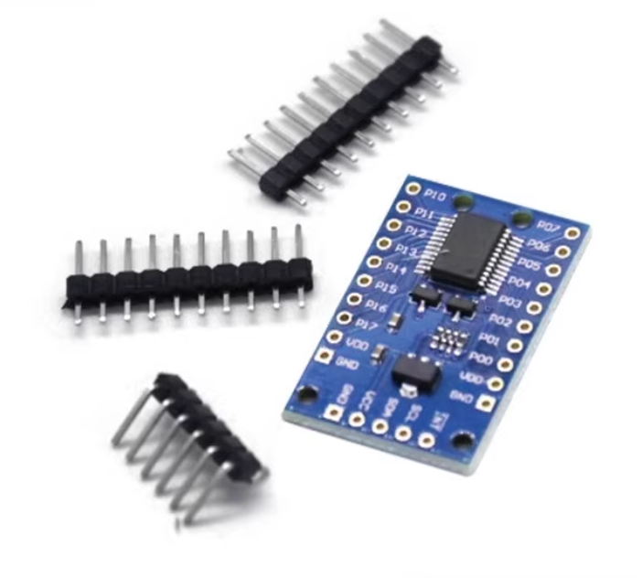
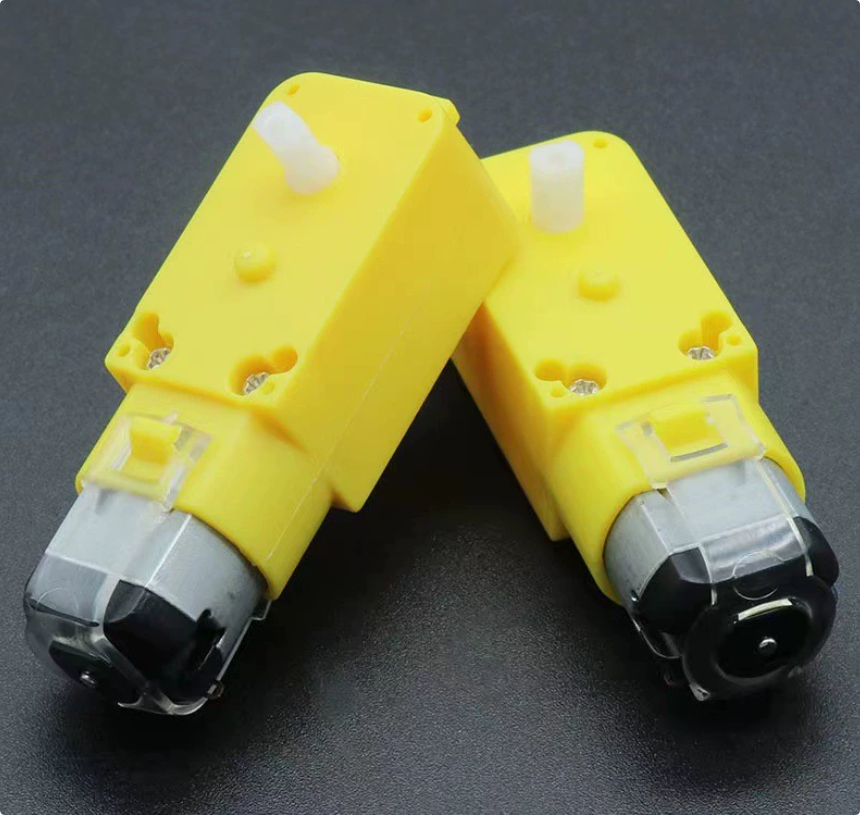
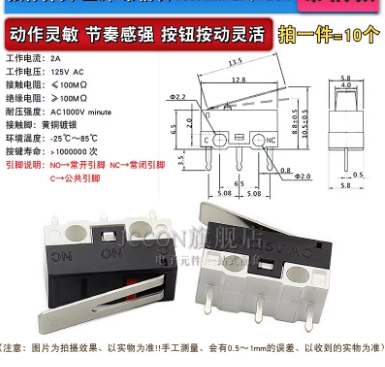
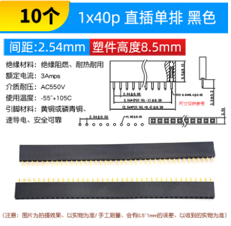

# 自动材料更换控制单元（团子 BMCU-ESP）

[交流群 1093447641 欢迎加入](https://qm.qq.com/q/hrK8NNwo6Y)

## 方案

### 最低成本（无io扩展模块，4色（最低24元）或者8色）
*** 必须 ***
- esp32（合宙esp32c3）
- tt电机（1/48黑头单轴）
- ttl转485模块（TX和RX最好，有DE也可以用就是了）
- drv8833电机驱动（黑版最好）
- 杜邦线

--- 可选 ---
- pcb版（没有画，用杜邦线连接吧）
- 微动（三脚带柄13.5mm按键微动）
- 弹簧外径5*长度10*线径0.4
- M3*20沉头螺丝
- M3*5沉头螺丝
- AMS数据线（4pin公对公，原厂线序，不是延长线）
- MX3 2*2 弯针座

### 团子pcb板子（最大支持16色）
*** 必须 ***
- esp32（合宙esp32c3）
- tt电机（1/48黑头单轴）
- ttl转485模块（TX和RX最好，有DE也可以用就是了）
- drv8833电机驱动（黑版最好）
- 杜邦线

--- 可选 ---
- [嘉立创pcb版 https://oshwhub.com/tz_simple/project_vsifmgrt](https://oshwhub.com/tz_simple/project_vsifmgrt)
- 微动（三脚带柄13.5mm按键微动）
- PCF8575 (io扩展模块)
- AMS数据线（4pin公对公，原厂线序，不是延长线）
- MX3 2*2 弯针座
- 弹簧外径5*长度10*线径0.4
- M3*20沉头螺丝
- M3*5沉头螺丝

#### 多个 PCF8575 说明
0x20 (默认) 项目需要的其他三个按照下面进行配置就可以了

| I2C 总线地址 | A2  | A1 | A0 |
|---|---|---|---|
| 0x20 | GND | GND | GND | 
| 0x21 | GND | GND | VCC |
| 0x22 | GND | VCC | GND |
| 0x23 | GND | VCC | VCC |
| 0x24 | VCC | GND | GND |
| 0x25 | VCC | GND | VCC |
| 0x26 | VCC | VCC | GND |
| 0x27 | VCC | VCC | VCC |

## 烧录教程
1. 在 [Releases](https://github.com/tsimplez/bmcu-esp/releases) 处下载适合的esp32固件
2. 电脑使用typec连接好esp32
3. 打开 [在线烧录网站](https://web.esphome.io)
4. 点击连接 -> 左上角选择串行端口 -> 点击安装（在 准备首次使用 旁边） -> 选择下载好的固件安装就可以了
5. 最后连接esp32 的 wifi（BMCU_xxxxxx）访问 [192.168.4.1](http://192.168.4.1)

## BOM清单
也可以看这个清单 https://b.242499.xyz/bmcu
### 必须
| 品名 | 参考图  | 数量 | 说明 |
|---|---|---|---|
| esp32 |  | 1 | 简约 和 经典 都可以 | 
| RS485模块 TTL转RS485 |   | 1 | 两种都可以 |
| PCF8575 |  | 2 | 一个就是4色 两个就是8色 3个12色 4个16色 |
| DRV8833电机驱动 |  | 4 | 一个控制两个电机 |
| TT电机 1/48黑头单轴 |  | 8 | 白头应该也可以 几色就几个 |
| 压板弹簧外径5*长度10*线径0.4 |  | 8 | 无所谓，长了就剪 |
| M3沉头螺丝 |  | * | 推荐每个规格都买(平时也用的到) 一种的话推荐(M3*20) |

### 可选
| 品名 | 参考图  | 数量 | 说明 |
|---|---|---|---|
| 三脚带柄13.5mm按键微动 |  | 8 | 可以不要 功能(可自吸和耗材在线检测) 至少一个电机一个|
| AMS数据线（4pin公对公，原厂线序，不是延长线） |  | 1 | 杜邦线也不是不能用 打印机ams接口是(上左 B 上右 A 下左 GND 下右 24V)和485模块的关系是(A接A B接B) | 
| MX3 2*2 弯针座 |  | 1 | AMS数据线接口 |
| mini 5V电源模块 |  | 1 | 不用也可以 用手机数据线(type-c)接esp32 |
| 2.54排母，要4P 5P 6P 10P 16P 可以直接买一份1x40P的自己剪断 |  | * | 不要也可以 直接焊接到pcb上(不方便拆) 买2P和3P组合使用也可以|
| xh2.54直针插座|  | * | 一个电机一个 |
| 温湿度模块|  | * | 可选|

## 项目简介

团子 BMCU 是一套面向 3D 打印机的自动材料更换控制单元固件，实现了与 Bambu Lab 打印机的
BambuBus 通信协议，支持多通道耗材管理、电机控制、编码器模拟与微动开关检测

- **平台适配层**，同一套控制逻辑可在 RP2040 / ESP32-S3 / ESP32-C3 上编译运行
- **ESP32 网页管理**（配网、参数、手动进退料、日志、OTA）
- **日志总线**、**引脚配置**、**设置迁移**与 **OTA 发布工具**；

> 本固件基于社区逆向工程实现，与 Bambu Lab 官方无关，仅供学习研究，非官方支持版本

## 项目特色
空打 缠料 检测支持(制作中)
需要把 离线 切换回 在线或者自动（使用电机堵转实现（打印机会退料在进料（只能直接离线）有概率提示堵转））

## 支持的平台

| PlatformIO 环境 | 主控 | 说明 |
|---|---|---|
| `pico` | RP2040（Raspberry Pi Pico） | 默认环境设置存片内 Flash；BambuBus 走 UART0；无网页（Web 层为空实现）（考虑删除中） |
| `esp32s3` | ESP32-S3 | 16 MB Flash + OPI PSRAM，`default_16MB.csv` 分区；日志走 UART0（GPIO43/44） |
| `esp32c3` | ESP32-C3 | 4 MB Flash，`min_spiffs.csv` 分区（双 OTA 槽）；默认 4 通道直连 GPIO |
| `airm2m_core_esp32c3` | 合宙 AirM2M CORE ESP32-C3 | 同上分区与引脚方案，板载 LED 在 GPIO12/13 |

平台差异集中在 `src/platform.h` / `src/platform.cpp`，其余文件保持平台无关

## 主要特性

- **多通道材料管理**：AMS 数量 1–4，每个 AMS 对应 4 个通道（最多 16 路）；未接线（引脚为「无」）的通道不可启动电机
- **BambuBus 通信**：与打印机交互，支持 RS485 两种收发方式；可选原始报文日志
- **电机控制**：进料 / 退料 / 停止，支持同时运行电机数上限与排队，超时自动停车；打印机进料结束后的停止延迟可在网页自定义
- **微动开关检测**：自动模式按微动状态更新通道；微动辅助进料（时长可配，0=关闭）
- **49E 霍尔与通道卡片**：每通道可配置主控 ADC 输入，网页显示当前使用通道、原始读数、近 1 秒与近 5 秒平均值及最近一分钟的曲线；短期平均值按窗口内完整 200 ms 桶的有效样本数加权，不足窗口时使用已有样本，无样本显示「—」，每秒刷新；接线数量受主控 ADC 资源限制
- **AS5600 编码器模拟**：模拟磁编码器，返回角度、磁场状态与速度
- **引脚可配置**：电机、通道微动、五通总微动与霍尔引脚由 `io_config` 管理，可在网页里选择与校验；配置 I2C 后微动可选择 PCF8575 扩展输入，霍尔只允许主控 ADC
- **设置存储**：使用魔数 + CRC32 校验，写入由存储后端保障（RP2040 片内 Flash / ESP32 NVS）
- **日志总线**：主板日志与 BambuBus 报文两路环形缓冲，网页按游标增量拉取，写入不阻塞
- **网页管理 / OTA**：ESP32 平台提供配网热点、管理页面与在线/本地固件升级
- **看门狗**：防止程序卡死（10 秒任务看门狗）
- **逐台 AMS 身份**：完整序列号固定为 `0EA + AMS 编号（0..3）+ 12 位后缀`；网页 AMS 1～4 各自设置后缀和版本，并显示实际完整序列号。后缀留空时取芯片 ID 的低 48 位，再把最后一位替换为 AMS 编号；自定义后缀原样保留
- **身份保持**：四份配置独立保存，减少 AMS 数量不会清除停用台的身份；只有实际序列号变化的 AMS 重新报名。AMS 版本默认均为 `1.0.6.87`，可以逐台设置为相同或不同版本
- 打印机可能缓存旧身份；修改后若仍显示旧序列号或不能重新注册，需要让打印机重新枚举连接。网页“实际完整序列号”显示固件当前使用的值，不代表打印机缓存已刷新

## 软件架构

### 目录结构

```
src/
├── main.cpp/h          # 程序入口：初始化各层并跑主循环
├── platform.cpp/h      # 平台适配层（HAL）：引脚映射、I2C、UART、看门狗、非易失存储
├── BMCU.cpp/h          # 自动材料更换控制核心（电机、微动、编码器模拟、AS5600）
├── BambuBus.cpp/h      # BambuBus 协议实现
├── Motor.cpp/h         # 电机驱动封装
├── io_config.cpp/h     # 电机/微动引脚配置：默认值、校验、可选引脚与标签
├── settings_storage.cpp/h  # 设置存储（当前格式、CRC32、默认值与加载）
├── project_presets.cpp/h   # 项目接线预设、校验、应用和当前配置匹配
├── log_bus.cpp/h        # 日志总线：两路环形缓冲 + 增量读取
├── web_config.cpp/h    # 网页管理（仅 ESP32，其它平台为空实现）
├── PCF8575_PinMap.cpp/h# PCF8575 GPIO 扩展
├── crc_bus.c/h         # BambuBus 收发 CRC8 / CRC16 查表校验（不依赖 lib/CRC）
└── version.h           # 固件版本与 OTA 板型键名（FW_VERSION / FW_TARGET）

web/index.html          # 管理页面，构建时作为二进制块编入固件
```

### 主循环

```
setup():  控制台/看门狗/日志 → 加载设置 → 释放 USB 焊盘 → I2C → BMCU_init → web_config_init
loop():   喂狗 → BMCU_run（协议/总线） → 微动状态检查 → web_config_run（网页） → yield()
```

### 平台适配层（`platform.h` / `platform.cpp`）

- 引脚映射：按 `CONFIG_IDF_TARGET_ESP32C3` / `ARDUINO_ARCH_ESP32` / RP2040 分组，未使用的通道用 `PIN_NONE(255)` 占位
- 非易失存储：ESP32 用 NVS（命名空间 `settings` / `filament`），RP2040 用片内 Flash 固定偏移，接口统一为 `hal_storage_read/write`
- 总线串口：ESP32 用 `Serial1`（事件回调，RX 缓冲 2048），RP2040 用 `uart0`（中断），均为 8E1
- 看门狗、I2C、控制台串口均在此层实现

### 设置存储（`settings_storage`）

- 运行期设置包括：退料超时、通道模式、AMS 数量、手动点动时长、微动辅助进料时长、进料停止延迟、电机并发上限、RS485 模式、报文日志开关、序列号后缀、AMS 版本、OTA 源与提示开关、含五通总微动的 IO 引脚配置、I2C 接线、总线接线
- 当前设置格式为 `0x5341542F`，包含霍尔接线与各通道停转检测参数；旧格式会恢复整份默认设置，包括接线和 AMS 数量，不迁移历史记录。耗材记录格式同步升为 `2`，旧耗材记录也恢复默认值，包括耗材信息和当前通道；升级前应记录现有配置
- `GET/POST /api/settings` 的 `feed_stop_delay_ms` 对应 `FEED_STOP_DELAY_MS`，范围 0～29999 毫秒，默认 1000，0 表示立即停车。保存后用于下一次安排延迟停车，已开始的延迟保持原截止时间；显式停止请求仍立即停车
- `GET /api/settings` 的 `io.switch_pin` 返回五通总微动输入；保存时用 `io_switch` 与全部启用通道的 `io_mfN`、`io_mbN`、`io_swN` 一起提交。支持 GPIO、PCF8575 输入和 255（无），不允许与通道、UART 或 I2C 引脚重复。`PIN_SWITCH` 只作为平台默认值：C3 和 Pico 为“无”（Pico GPIO0 用于 UART0 TX），S3 为 GPIO42
- `GET /api/settings` 的 `ams_identity` 返回四个对象：`index`（0..3）、`serial`（自定义后缀）、`effective_serial`（实际完整序列号）、`ams_version`、`enabled`。保存单台使用 `POST /api/settings` 的 `ams_index` 加 `serial` / `ams_version`；`ams` 仍表示数量，身份字段缺少编号会被拒绝
- 记录带格式标识（`SETTINGS_MAGIC_NUMBER`）与 CRC32；仅加载当前格式，格式不匹配或校验失败即恢复默认值，不迁移历史记录
- 保存失败时用内存快照回退，避免读到不完整 Flash
- 启动与保存后都会把生效设置打印到主板日志，便于排查

### 霍尔停转检测（`hall_sensor`）

- 在各通道「49E 霍尔」标题旁点击「检测设置」，设置 ADC 下限、上限和无转动超时；三项一起保存，写入并回读校验成功才生效。下限与上限须满足 `0 ≤ 下限 < 上限 ≤ 4095`；超时范围 `0..3600` 秒，`0` 关闭检测，默认 `1000 / 3000 / 0`，各通道独立保存
- 图上始终显示标有数值的两条阈值虚线，自动纵轴包含两条线；关闭检测或尚无采样时也可查看已保存阈值。请根据实际安装后的原始曲线设置上下限，避免使用一秒或五秒均值判断磁极变化
- 固件以原始 ADC 采样进行双阈值检测：连续三次 `≤ 下限` 或 `≥ 上限` 才确认所在区域；首次确认只建立基准，之后确认从低区到高区或从高区到低区才刷新转动时间。持续停在高区、低区或中间区都会超时；短暂尖峰不会刷新计时
- 只有打印机以新鲜报文确认「当前使用」的一个通道执行判断，其他通道继续采样、显示统计和每秒日志。超时从首次有效采样开始；切换通道、检测参数或霍尔接线后重新计时；读取失败、ADC 初始化失败或超过 500 ms 无采样单独显示采样异常，恢复采样后重新计时
- 当前使用通道全局唯一，编号保存在耗材记录中，由后台限频保存并回读校验；重启或通信失效时显示「使用通道 · 等待确认」，收到新的使用报文才开始检测。普通轮询保留待确认记录，明确停止、退料、切换、通道离线或缩减启用数量会清除相应使用记录；不会恢复电机动作或累计关机时间
- 超时和恢复移动各记录一次主板日志，网页显示固件状态；`hall_sensor_detection_status()` 提供当前检测快照，`hall_sensor_last_event()` 提供最新事件及启动内递增序号，查询不消费事件。后续调用方应按序号去重，并重新检查活动通道和状态；当前仅提示，**不调用 `BambuBus_request_pause_test()`，不自动暂停打印**
- `GET /api/settings` 的 `hall_detection` 数组按全局通道顺序返回 `lower`、`upper`、`timeout_s`；`POST /api/hall/detection` 使用表单字段 `channel`（从 0 开始）、`pin`（打开弹框时的霍尔引脚）、`lower`、`upper`、`timeout_s`。通道或数值错误返回 400，接线已变更或无有效 ADC 引脚返回 409，写入或回读失败返回 500 且保留原运行配置；成功返回 `ok`、`channel`、`pin` 和 `detection`
- `GET /api/hall` 每通道的 `detection` 包含上述配置、`state` 和 `idle_ms`，状态为 `inactive`、`pending`、`waiting`、`monitoring`、`timeout` 或 `sensor_error`；顶层 `event` 包含 `sequence`、`channel`、`type`，事件类型为 `none`、`timeout`、`recovered`、`sensor_error` 或 `sensor_restored`。`GET /api/status` 的 `current_channel_state` 增加 `pending`，仅供显示待确认的使用记录

### 日志总线（`log_bus`）

- 两路固定大小环形缓冲：主板日志（`LOG_MAIN`）与 BambuBus 原始报文（`LOG_BUS`）
- 缓冲区大小：ESP32 为主板 4 KB / 总线 64 KB，RP2040 为主板 2 KB / 总线 8 KB
- 写入永不阻塞（可在中断/事件回调中调用）；网页以游标增量读取，支持清空
- `LOG_MAIN` 同时输出到串口控制台，`LOG_BUS` 只进缓冲
- 主板日志按系统/其他、霍尔、电机、打印机、自动进料、BambuBus、暂停实验、设置/存储、I2C/环境、网页/配网和 OTA 升级筛选；支持全选、全不选，并独立保存浏览器勾选状态
- 霍尔在主循环中每通道首次采样及此后每秒记录一次当前 ADC 原始值或读取失败，包含通道编号和 IO 引脚；未配置的通道不记录，正常采样仍为每通道每秒 20 次
- BambuBus 报文按报文类型过滤显示；「抓取 30 秒」在前端按当前勾选的显示类型抓取未来 30 秒的报文，抓完自动下载 `.log` 文件；两路日志的普通「下载」均包含当前通道的全部浏览器缓存，不受显示筛选影响

## 网页管理

仅 ESP32 平台生效，RP2040 为空实现（不影响编译）

- **访问方式**：上电连不上已保存 WiFi 时开启配网热点（SSID `BMCU_<芯片ID后6位>`，密码 `12345678`），浏览器自动弹出配网页；
  联网后访问 `http://<设备IP>/` 或 `http://<mDNS名称>.local/`（默认 `bmcu`，可在配网页自定义）；同一局域网重名时自动使用 `bmcu-2`、`bmcu-3` 等编号，实际地址见配网页「当前访问地址」或日志
  自动编号不覆盖保存的名称，重启后重新检测重名；自定义名称同样适用，若名称已有 `-数字` 后缀则递增该数字；热点密码与 HTTP 接口为固定/无认证，见「已知限制」
- **自动重连**：已保存 WiFi 连接超过 15 秒仍未成功时开启配网热点，每次失败后等待 30 秒再尝试，重试期间保持热点和配网页可用；连上后自动关闭热点并恢复局域网访问，无需重启
  运行中掉线也会自动重连，超时后采用同样的配网与重试流程；未配置或已忘记网络时只开启配网热点
- **页面分页**：状态、配网、设置、固件更新、日志
- **主要接口**：

| 接口 | 方法 | 用途 |
|---|---|---|
| `/api/status` | GET | 运行状态、通道与电机状态、耗材颜色与透明度、并发上限等；`mdns` 为配置名称，`mdns_active` 为实际名称（离线或待更新时为空） |
| `/api/settings` | GET / POST | 读取 / 保存通道参数 |
| `/api/bus` | POST | 保存 BambuBus 接线与 RS485 模式 |
| `/api/pcf` | POST | 保存 I2C 接线（SDA/SCL 同时有效才启用） |
| `/api/motor` | POST | 手动进退料（`motor` / `dir` / 可选 `duration`） |
| `/api/scan` | GET | 扫描 WiFi |
| `/api/wifi` / `/api/mdns` / `/api/forget` | POST | 保存 WiFi / 保存 mDNS 名称 / 清除 WiFi |
| `/api/log` | GET | 增量拉取日志（`dl=1` 下载附件） |
| `/api/hall` | GET | 霍尔当前值、短期均值与增量历史；通道的 `avg_1s` / `avg_5s` 为近 1 秒 / 5 秒有效样本平均 ADC 值，无有效样本返回 `null` |
| `/api/hall/detection` | POST | 保存单通道霍尔 ADC 上下限与无转动超时，字段和状态见霍尔停转检测说明 |
| `/api/ota/check` / `pull` / `upload` | POST | 检查更新 / 在线更新 / 本地上传 |
| `/api/reboot` | GET | 重启 |
| `/api/factory` | POST | 恢复默认设置 |

- 手动进退料按硬件能力显示（C3 4 路 / Pico、S3 8 路）；每次点动默认 300 ms，固件先停电机再响应
- 变更项（通道状态、退料时间、微动辅助时间、手动时长、进料停止延迟、并发上限等）保存后写入 Flash
- 每张通道卡片的标题后显示耗材颜色圆点，深色边框与浅色外环使黑白色也能辨认；悬停显示颜色值。`GET /api/status` 的 `filament_colors` 按从 0 开始的全局通道顺序返回 `#RRGGBB` 数组，长度为当前启用通道数，圆点按 RGB 实色显示。颜色来自固件耗材记录，可能是打印机下发值、已保存值或默认值；字段缺失或无效时显示空心圆并提示“颜色未知”，连接中断或状态过期时保留最近颜色并提示“上次读取”
- 圆点旁显示透明度百分比，0% 表示不透明，100% 表示完全透明；`GET /api/status` 的 `filament_alpha` 按与颜色相同的通道顺序返回 0–255 的 A 分量，网页按 `round((255-A)*100/255)` 换算。透明度缺失或无效时显示“透明度 —”并提示“透明度未知”；连接中断或状态过期时保留最近百分比并提示“上次读取”
- 「状态 → 通道参数与手动进退料」可填写进料停止延迟；「设置 → 电机与微动引脚」可选择五通总微动，与通道接线一起保存。总微动下降沿让当前选中且空闲的通道进料 200 毫秒；改线后首次读数只建立基线，扩展器离线时不触发。接线由主循环应用，网页回调不驱动电机

## 编译与烧录

```bash
# 安装 PlatformIO 后
pio run                      # 编译（默认环境 pico）
pio run -e esp32s3           # 指定环境
pio run -e esp32c3 -t upload # 编译并上传
pio run -t clean             # 清理
```

- 公共依赖在 `[env]` 中声明（PCF8575），网页 `web/index.html` 通过 `board_build.embed_txtfiles` 编入固件
- `pico` 环境需 `lib_ignore` 忽略 ESP32 专用库（WiFi/DNSServer/ESPmDNS/WebServer/Preferences）；`upload_protocol = picotool`
- C3 默认日志走 UART0；若要用板载 USB 看日志需追加 `-DARDUINO_USB_CDC_ON_BOOT=1`

## 有关于市面上的 bmcu 项目
- Top ams 和 天枢TTC 相似
- 孔明 和 怪兽 相似

### Ams Lite Mini 485
[教程 https://docs.qq.com/doc/DVm9tRkhkSXF1ZGZi](https://docs.qq.com/doc/DVm9tRkhkSXF1ZGZi)

### Top ams
之前使用此方案的，可以很方便迁移到本项目（只需要加 1个ttl转485模块）
- ***不推荐使用的是(mqtt方案)，其他项目都是使用485方案(和打印机直接通信)***
- 功能: 微动
- 群: 882091399
- [教程 https://docs.qq.com/doc/DVkZIR0NtYUtsenB6](https://docs.qq.com/doc/DVkZIR0NtYUtsenB6)
- [仓库 https://github.com/nccrrv/Top-AMS](https://github.com/nccrrv/Top-AMS)
- [tt模型 https://makerworld.com.cn/models/1418429](https://makerworld.com.cn/models/1418429)

### 天枢TTC
之前使用此方案的，可以很方便迁移到本项目（只需要加 一个esp32 ）
- 功能: 微动
- 群: 981655616
- [教程 https://my.feishu.cn/wiki/N4bXwJpWUirYBFkMr81cw0umn72](https://my.feishu.cn/wiki/N4bXwJpWUirYBFkMr81cw0umn72)
- [仓库 https://github.com/hu504011383/Tianshu](https://github.com/hu504011383/Tianshu)
- [tt模型 https://makerworld.com.cn/models/1418429](https://makerworld.com.cn/models/1418429)
- [TTC模型 https://makerworld.com.cn/models/2226484](https://makerworld.com.cn/models/2226484)

### 孔明(主板使用ttl烧录)
- 功能: 霍尔 + 双微动 + 370电机
- 群 981889040
- [教程 https://b23.tv/zsuv8dt](https://b23.tv/zsuv8dt)

### 怪兽(比孔明的主板多了typec烧录(340芯片)(烧录更简单))
- 功能: 霍尔 + 双微动 + 370电机
- 群 1025731130
- [教程](https://b23.tv/F88rm5g)
- 26-10-17: 配件包价格 185(塑料)

### bmcu pro
- 功能: 霍尔 + 双微动 + 370电机 + 回卷
- 群 735647789
- [教程 https://www.yuque.com/yuqueyonghu-yxa2f7/uv47x9](https://www.yuque.com/yuqueyonghu-yxa2f7/uv47x9)

### NeMCU
- 功能: esp32 + 全霍尔 + 370电机
- 群 851019565

### 波兰固件
[仓库](https://github.com/jarczakpawel/BMCU-C-PJARCZAK)

#### 和 bmcu-esp(本项目) 的区别
本项目基于[Tianshu](https://github.com/hu504011383/Tianshu)
然后 Tianshu 似乎是基于 BMCU-C-PJARCZAK 的 V9 PJarczak 2026/2/24 07:04 修改而来
所以 本项目一样也是
不过 后续会同步一些相同的地方，文件上方有标记

https://github.com/RobTillaart/PCF8575

### 其他
#### 最新版本支持（第一次打印有效）
https://github.com/Le-Maxime/BMCU-U
https://github.com/jarczakpawel/BMCU-Flasher

欢迎补充内容

## 待处理
打印机退料 -> 5秒后打印机要求停止 -> 打印机进料
似乎和 AS5600_get_distance_E _filament meters 长度有关系

好像要是AMS_COUNT要是4个就得输入4个序列号了吧，不然都是一样的
