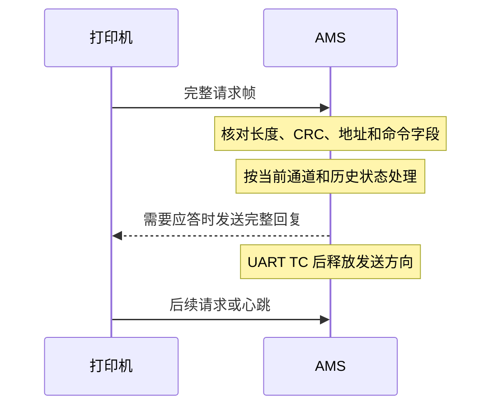
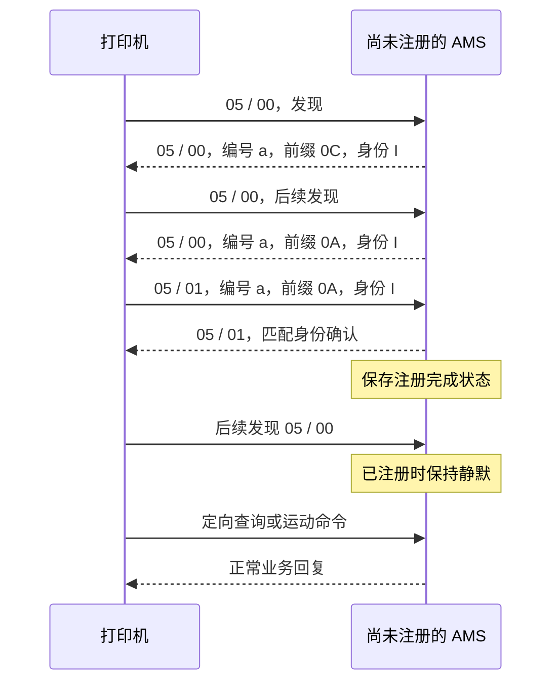
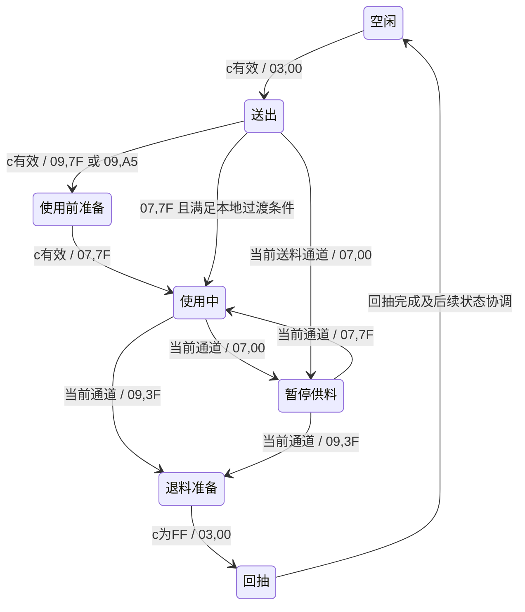

# BambuBus 协议分析

分析日期：2026-10-25。范围：打印机与 AMS 之间、以 `0x3D` 为帧头的 BambuBus 通信。

本文记录可从收发代码交叉核对的字节布局、数据编码、请求与响应关系，以及打印过程中的通信状态。主要依据 BMCU-U 固定源码快照，不是厂商发布的完整协议规范，也不是实机抓包报告。尚未确定的语义标为“未知”；参考实现采用的常量和时序标为“观察值”，不把它们规定为所有打印机必须遵循的值。

文内 `[U1]` 等证据编号见文末。项目兼容范围、实现差异和移植风险单独记录在 `BambuBus项目差异与兼容性调查.md`。

## 1. 术语与读表约定

| 记号 | 含义 |
|---|---|
| `F[n]` | 完整帧的第 n 字节，从帧头 `0x3D` 开始，零基偏移 |
| `P[n]` | 长帧业务载荷的第 n 字节；`P[0] = F[13]` |
| `L` | 完整帧字节数，包括帧头、所有载荷和末尾 CRC16 |
| `N` | 长帧载荷字节数；`L = N + 15` |
| `LE16` / `LE32` | 小端 16 位 / 32 位整数 |
| `float32-LE` | 4 字节 IEEE 754 单精度浮点数，小端存储 |
| `a` / `c` | AMS 编号 / AMS 内部通道编号 |
| RX / TX | 本文统一以 AMS 为观察点：RX 是打印机发来，TX 是 AMS 回复 |
| Cxx | 源码对短头命令 `0x03` 的称呼，不是额外的线缆命令号 |
| Dxx | 源码对短头命令 `0x04` 的称呼，不是长头帧格式 |
| Fxx | 源码对发现/注册一类交互的称呼，主要对应短头命令 `0x05` |

**帧头格式与业务包名必须分开：`0x03`、`0x04` 都使用短帧头。真正的长帧有 16 位序号、源/目标地址和 16 位命令码。** `filament_motion_long` 这个内部名称只是指状态内容较长，不能据此把 `0x04` 按长帧头解析。[U1]

命令表中的“至少”表示读完已知字段并留出 CRC 所需的安全下限，不能反推打印机实际只发送这么多字节。未分析的扩展字段应保留；也不能把源码解析器愿意接收某个长度，当作该长度已经被打印机证实有效。

## 2. 总线与串口

### 2.1 串口参数

| 项目 | 已核对的通信参数 |
|---|---|
| 电气传输 | UART 经 RS485 收发器，半双工 |
| 波特率 | 1,250,000 bit/s |
| 数据位 | 8 |
| 校验位 | 偶校验，1 位 |
| 停止位 | 1 |
| 常用串口配置名称 | `8E1` |
| 流控 | 无 RTS/CTS 硬件流控 |
| 发送结束判定 | UART 的 TC，即末字节完整移出后恢复接收 |

CH32 的 `USART_WordLength_9b` 与偶校验组合在这里表示 **8 位有效数据加 1 位校验**，不能照抄成其他平台的“9 位数据再加校验”。GPIO 编号和 DE 极性属于硬件实现，不是协议字段。[U2]

8E1 每字节占 11 个比特，理想线上时间为 `8.8 μs × L`：12 字节约 105.6 μs，44 字节约 387.2 μs，60 字节约 528 μs，146 字节约 1284.8 μs。以上只计串行传输时间，不含处理、等待和收发器切换。

### 2.2 会话模型

已实现的业务以打印机请求、AMS 应答为主。发现请求可以让尚未注册的设备报名；定向请求只由命中的 AMS 处理。心跳和未实现命令不一定有回复，不能用“每个 RX 都应有一个 TX”解释日志。[U1]



此图表示收发关系，不规定所有命令的固定顺序、最大应答时间或重试周期。

### 2.3 共线协议边界

参考代码也识别 `0x33` 开头的 AHUB 数据，但其长度算法、载荷和状态机属于另一帧族。不能把它的 `长度字段 × 4 + 12` 公式用于 `0x3D` 长帧。本文不将 AHUB、网络授权接口或切片软件通信纳入 BambuBus 命令表。[U2、U3]

## 3. 帧格式

### 3.1 短帧头

```text
偏移     0    1      2     3      4      5 ... L-3       L-2  L-1
字段    3D   flags   L    CRC8   command   业务字段       CRC16-LE
```

| 完整帧偏移 | 长度 | 定义 |
|---|---:|---|
| 0 | 1 | 同步字节 `0x3D` |
| 1 | 1 | 标志；bit7 为 1 表示短帧头 |
| 2 | 1 | 总长度 `L`，包括 CRC16 |
| 3 | 1 | CRC8，覆盖 `F[0..2]` |
| 4 | 1 | 8 位业务命令 |
| 5 至 L−3 | L−7 | 命令专属字段，不能统一视作地址 |
| L−2 至 L−1 | 2 | CRC16，覆盖 `F[0..L−3]`，低字节先传 |

含命令的结构下限为 7 字节。单字节长度可表达至 255；这只是编码上限，不表示每个命令都允许 255 字节。[U1、U3]

已使用的 flags：

| 方向/用途 | 值 | 可以确认的含义 |
|---|---|---|
| 打印机请求 | `0xC5` | 参考实现按这个完整值识别短帧请求 |
| 普通固定回复 | `0xC0` | 注册回复及部分固定 ACK 使用 |
| 运动回复 | `0xC0 \| (q << 3)` | `q = 0..7` 的循环计数写入 bit3..5 |

运动回复的 flags 依次可为 `C0 C8 D0 D8 E0 E8 F0 F8`。`q = (flags >> 3) & 7`。这个计数来自 AMS 的发送状态，**不是回显请求中的 16 位序号**。其余标志位的完整路由/控制语义尚未由本次证据确定。[U1]

### 3.2 长帧头

```text
偏移   0   1    2..3   4..5   6     7..8   9..10  11..12  13..L-3  L-2..L-1
字段  3D flags  seq    length CRC8  target  source  type    payload   CRC16
```

| 完整帧偏移 | 长度 | 编码/含义 |
|---|---:|---|
| 0 | 1 | `0x3D` |
| 1 | 1 | bit7 为 0；已识别的请求值为 `0x05` 或 `0x04`，回复为 `0x00` |
| 2..3 | 2 | `seq`，LE16 |
| 4..5 | 2 | 总长度 `L`，LE16 |
| 6 | 1 | CRC8，覆盖 `F[0..5]` |
| 7..8 | 2 | 目标地址，LE16 |
| 9..10 | 2 | 源地址，LE16 |
| 11..12 | 2 | 命令类型 `type`，LE16 |
| 13..L−3 | N | 业务载荷 `P` |
| L−2..L−1 | 2 | CRC16，小端 |

固定开销为 15 字节：13 字节头部加 2 字节 CRC16，故 `N = L − 15`。源码中从偏移 2 复制的“11 字节头”不包含最前面的 `3D flags`。[U1]

参考实现接受的 AMS 目标地址为 `0x0700`，在线缆中表现为 `00 07`。这里仍需按业务载荷中的 AMS 编号选择设备，不能把源/目标地址与通道编号混为一谈。[U1、U3]

已实现长帧的回复关系：

```text
response.seq    = request.seq
response.type   = request.type
response.source = request.target
response.target = request.source
response.flags  = 0x00
```

不能把打印机源地址写死为某个值。本文十六进制构造样例选用 `0x0300` 仅用于演示地址交换；实际回复以实际请求为准。`0x04` 与 `0x05` 两种请求 flags 的更细差别尚未确定。[U1]

## 4. CRC 与完整性

### 4.1 参数

| 参数 | CRC8 | CRC16 |
|---|---|---|
| 位宽 | 8 | 16 |
| 多项式，不含最高次项 | `0x39` | `0x1021` |
| 初值 | `0x66` | `0x913D` |
| 输入/输出反射 | 无 | 无 |
| 最终异或 | `0x00` | `0x0000` |
| 覆盖范围 | 短头前 3 字节；长头前 6 字节 | 除末尾 CRC16 外的整帧，包含已写入的 CRC8 |
| 传输顺序 | 单字节 | 结果低字节、高字节 |

CRC16 的计算是高位先移位，但计算结果在帧中按小端保存；这是两个不同概念。[U4]

逐位算法可以写成：

```text
r = init
逐个处理输入字节 b：
    r ^= b << (width - 8)
    重复 8 次：
        若 r 的最高位为 1：r = (r << 1) XOR polynomial
        否则：            r = r << 1
        r &= (1 << width) - 1
返回 r，不做最终异或
```

本次用该算法逐项核对了源码的两张 256 项查表。

| 校验输入 | CRC8 | CRC16 |
|---|---|---|
| 空字节串 | `66` | `913D` |
| ASCII `123456789` | `79` | `2614`，在线保存为 `14 26` |
| 短头 `3D C5 0C` | `C8` | 不适用 |

### 4.2 接收与发送检查顺序

从流中找到同步字节后，依据 bit7 选择头部格式，读取完整长度字段，校验头部 CRC8，再收齐 `L` 字节并校验 CRC16。通过完整性检查后，才能读取命令专属字段、匹配地址、改变状态或构造业务回复。

发送时先确定实际帧长并写入长度字段，再计算 CRC8，最后计算 CRC16。载荷内出现 `0x3D` 不能直接作为新帧开始；帧界限由长度决定。本次证据中的构帧代码没有对载荷进行字节转义。[U1、U3]

帧长合法不等于业务载荷足够。比如长帧 `0x0218` 至少需要 34 字节已知载荷，仅检查 `L >= 15` 不足以安全读取该命令。CRC 正确但不属于本设备的帧，也不应驱动本设备运动。

## 5. 已识别命令总表

方向均以 AMS 为观察点。下表 RX 下限从字段访问范围推导，固定回复长度来自实际数组或紧凑结构体大小。[U1]

| 帧头 | 命令 | 功能 | RX 已知长度/字段 | TX 已实现格式 |
|---|---|---|---|---|
| 短 | `0x03` | 运动控制及运动反馈 | 12 字节布局 | 44 字节短帧 |
| 短 | `0x04` | 运动控制、通道及环境状态 | 13 字节布局 | 60 字节短帧 |
| 短 | `0x05` | 发现、注册确认 | subtype 00 下限 8；subtype 01 身份比较下限 26 | 29 字节短帧或保持静默 |
| 短 | `0x06` | 名为 REQx6 的请求 | 完整语义未知 | 本次主要参考无应答处理 |
| 短 | `0x07` | 源码命名为 NFC 检测 | 完整语义未知 | 本次主要参考无应答处理 |
| 短 | `0x08` | 写耗材属性 | 读取至 F[42]，至少 45 字节 | 8 字节短帧 ACK |
| 短 | `0x20` | 打印机心跳 | 有 33 字节样例；其余载荷语义未知 | 无已实现回复 |
| 长 | `0x0103` | 查询版本与设备名称 | P[0] 为 AMS，至少 16 字节整帧 | 21 字节载荷，36 字节整帧 |
| 长 | `0x0211` | 查询耗材属性 | P[0..1] 为 AMS/通道，至少 17 字节整帧 | 131 字节载荷，146 字节整帧 |
| 长 | `0x0218` | 写耗材属性 | 至少 34 字节载荷，49 字节整帧 | 3 字节载荷，18 字节整帧 |
| 长 | `0x021A` | MC 在线/状态查询 | P[0] 为 AMS，至少 16 字节整帧 | 6 字节载荷，21 字节整帧 |
| 长 | `0x0402` | 查询序列号/身份 | 带选择字段的形式读取 P[33]；也接受未带该字段的形式 | 66 字节载荷，81 字节整帧 |

`0x040D`、`0x040E` 的证据边界见第 11 节；本次不能给出已验证的认证载荷或成功响应。

## 6. 发现、注册、身份与版本

### 6.1 AMS 与通道编号

本次覆盖的通信模型中，AMS 逻辑编号为 `0..3`，单台 AMS 内通道编号为 `0..3`。很多运动请求还允许 `c = 0xFF`，表示没有明确选择一个新通道，必须结合状态标志及当前通道解释。

常见显示可映射为 AMS A/B/C/D；需要本地平铺时可计算 `global_channel = a × 4 + c`。这个本地索引不是在线缆上统一发送的“0..15 通道号”。注册和身份必须区分各 AMS，而不是为每个通道注册一台 AMS。[U1、U5]

### 6.2 `0x05` 发现/注册格式

| 完整帧偏移 | 长度 | 含义 |
|---|---:|---|
| 4 | 1 | 命令 `05` |
| 5 | 1 | 子类型：`00` 发现，`01` 确认 |
| 6 | 1 | 目标/回复 AMS 编号；广播发现不能简单按此字段过滤 |
| 7 | 1 | 阶段前缀，已观察到使用 `0C` 和 `0A` |
| 8..23 | 16 | 设备身份块 |
| 24..26 | 3 | 29 字节回复中为 `00 00 00`，真实语义未知 |
| 27..28 | 2 | 29 字节回复的 CRC16 |

对于较短的广播发现请求，只能读取它实际携带的字段，不能把上述 29 字节回复布局强套到所有请求上。[U1]

参考交互为：

1. 打印机发 `05 / subtype=00` 发现请求。
2. 尚未注册的 AMS 报名，回复 subtype `00`、自己的 AMS 编号和身份；首次前缀为 `0C`。
3. 在后续发现中，尚未完成注册的 AMS 使用前缀 `0A`。
4. 打印机发 subtype `01` 定向确认；参考接受条件是 AMS 编号匹配，且 `F[7..23]` 的 17 字节与前缀 `0A` 加该设备身份一致。
5. AMS 回复 subtype `01`，记住注册完成。
6. 注册完成后，参考行为是对后续 subtype `00` 发现保持静默，正常服务其他请求；匹配的重复确认仍可得到回复。



这是一条从参考收发分支得出的交互路径，不表示打印机会以固定次数、固定时间间隔发送发现。`0C/0A` 的完整厂商定义、跨机型枚举策略和多设备报名冲突仲裁时序未完全确定。[U1]

### 6.3 注册身份与 `0x0402` 序列号

身份查询使用长帧。带设备选择字段的请求在 **`P[33]`，即 `F[46]`** 放 AMS 编号，不能误读成 `P[0]`。参考实现也接受载荷不超过 33 字节的查询形式；这不证明多台 AMS 应同时响应无选择字段的请求。[U1]

66 字节回复载荷：

| 载荷偏移 | 完整帧偏移 | 长度 | 含义/观察 |
|---|---|---:|---|
| 0 | 13 | 1 | 文本序列号长度，参考值 15 |
| 1..15 | 14..28 | 15 | 文本序列号，不是固件版本字符串 |
| 16..32 | 29..45 | 17 | 参考模板为零；字段划分未确定 |
| 33..48 | 46..61 | 16 | 设备身份块，与注册回复 F[8..23] 一致 |
| 49..57 | 62..70 | 9 | 参考模板为 `FF`，含义未知 |
| 58 | 71 | 1 | 参考模板为 `00` |
| 59..64 | 72..77 | 6 | 参考模板为 `FF 00 FF 00 FF 00`，含义未知 |
| 65 | 78 | 1 | AMS 编号 |

已知一致性关系：

```text
注册回复 F[8..23] == 序列号回复 P[33..48]
注册确认 F[7..23] == 被确认的前缀 + 同一份 16 字节身份
```

参考设备采用以 `0EA` 开头的 15 字节文本及以 `0E A0+a` 开头的二进制身份，通过芯片标识生成后续字节。该生成算法是模拟设备的身份分配策略，不是打印机提供的密钥，也不代表厂商认证成功。分析抓包时应保存原始身份字节，并区分文本身份和二进制身份。[U1]

### 6.4 `0x0103` 版本与设备名称

RX：`P[0] = a`。

TX：21 字节载荷，整帧 36 字节。

| 载荷偏移 | 完整帧偏移 | 长度 | 含义 |
|---|---|---:|---|
| 0..3 | 13..16 | 4 | 版本分量逆序存储：`D C B A` 对应显示 `A.B.C.D` |
| 4..19 | 17..32 | 16 | 设备名称区域，参考为 ASCII `AMS08` 后补零 |
| 20 | 33 | 1 | AMS 编号 |

参考回复版本字节为 `57 06 00 01`，按十进制分量显示为 **`01.00.06.87`**。`0x57` 是十进制 87，不能把该字段当 BCD，也不能显示成 `01.00.06.57`。[U1]

这里是 AMS 对打印机声明的版本，不是打印机自身的固件版本，也未必等于固件工程的发行版本号。设备名称与版本属于不同字段，修改其中之一不会自动改变另一项。

### 6.5 `0x021A` MC 在线/状态交互

RX：至少一个载荷字节 `P[0] = a`。

TX：载荷为 `a 00 00 00 00 00`。后 5 字节在参考实现中为零，不能据此把每一字节命名为某种成功标志、能力位或认证状态。回复仍回显序号和命令，交换地址。[U1]

## 7. 运动请求：打印机向 AMS 发什么

### 7.1 `0x03` 请求，12 字节

| 完整帧偏移 | 长度 | 含义 |
|---|---:|---|
| 0..3 | 4 | 短头，常见为 `3D C5 0C C8` |
| 4 | 1 | `03` |
| 5 | 1 | AMS 编号 a |
| 6 | 1 | 状态标志 s |
| 7 | 1 | 通道 c，`0..3` 或 `FF` |
| 8 | 1 | 运动标志 m |
| 9 | 1 | 未知；已有请求样例为 `02` |
| 10..11 | 2 | CRC16 |

### 7.2 `0x04` 请求，13 字节

| 完整帧偏移 | 长度 | 含义 |
|---|---:|---|
| 0..3 | 4 | 短头，常见为 `3D C5 0D F1` |
| 4 | 1 | `04` |
| 5 | 1 | AMS 编号 a |
| 6 | 1 | 状态标志 s |
| 7 | 1 | 运动标志 m |
| 8 | 1 | 未知；已有请求样例为 `03` |
| 9 | 1 | 通道 c |
| 10 | 1 | 未知；已有请求样例为 `00` |
| 11..12 | 2 | CRC16 |

**Cxx 的通道/运动标志位于 F[7]/F[8]；Dxx 位于 F[9]/F[7]。** 两者可以驱动相同状态转换，但不能使用同一个固定偏移读取输入。[U1、P1]

### 7.3 通道命令的组合语义

下表名称是从处理行为给出的解释，不是把内部枚举直接当作线上编码。必须联合查看 `c、s、m`，也必须考虑当前已装载通道。[U1]

| 通道 c | 状态 s | 运动 m | 已识别含义 |
|---|---|---|---|
| 0..3 | `03` | `00` | 送出/进料，进入 send_out |
| 0..3 | `09` | `7F` | 使用前准备，进入 before_on_use；有独立的反馈过程 |
| 0..3 | `09` | `A5` | 另一种使用前准备路径，同样进入 before_on_use |
| 0..3 | `07` | `7F` | 使用中/持续供料，进入或保持 on_use |
| 0..3 | `07` | `00` | 停止当前供料/暂停使用，进入 stop_on_use；不是卸载完成 |
| 0..3 | `09` | `3F` | 退料前准备，进入 before_pull_back |
| `FF` | `03` | `00` | 对已有当前通道执行回抽阶段，进入 pull_back；不能当作“给 FF 通道送料” |
| `FF` | `01` | 任意 | 就绪/无明确新通道的状态交互；不能无条件解释成正在打印的通道已卸载 |

未列出的组合不能靠枚举名称推定动作。尤其 `s=09` 不能一律解释成准备进料，因为 `m=3F` 是退料准备。

准备使用和使用中请求通常只在未装载其他通道，或请求命中当前装载通道时改变状态。停止、退料准备也依赖当前通道；这说明同一组输入字节在不同历史状态下可能得到不同结果，协议实现需要状态，不能只做静态查表。[U1]

## 8. 运动回复：AMS 向打印机报什么

### 8.1 `0x03` 回复，44 字节

以下是普通响应的基础布局。特殊准备阶段的动态状态区见 9.3，不能对所有状态强套同一套未知字段含义。[U1]

| 完整帧偏移 | 长度 | 类型 | 含义/观察 |
|---|---:|---|---|
| 0..3 | 4 | 短头 | `L=44 (0x2C)`，flags 含 3 位循环计数 |
| 4 | 1 | u8 | `03` |
| 5 | 1 | u8 | AMS 编号 |
| 6 | 1 | u8 | 未知，基础模板为 `00` |
| 7 | 1 | u8 | 使用标志：`00` 空闲、`02` 进/退料、`04` 使用相关阶段 |
| 8 | 1 | u8 | 当前通道，`FF` 表示无当前通道 |
| 9..12 | 4 | float32-LE | 当前通道的累计运动长度，单位米 |
| 13..14 | 2 | LE16 | 名为 pressure 的原始反馈字，物理单位未确定 |
| 15..16 | 2 | 原始字节 | 未知，随状态改变，不可一律固定 `FF FF` |
| 17..28 | 12 | 原始字节 | 未知动态/状态数据区 |
| 29 | 1 | 位图/原始字节 | 普通响应中为每通道 2 位在线/运动位图；特殊准备路径需保留原值 |
| 30..33 | 4 | 原始字节 | 未知状态区 |
| 34..37 | 4 | 原始字节 | 未知状态区 |
| 38 | 1 | u8 | 第二个当前通道字段，普通响应与 F[8] 一致 |
| 39 | 1 | 原始字节 | 未知，基础模板为 `00` |
| 40..41 | 2 | 原始字节 | 未知，基础模板为 `00 00` |
| 42..43 | 2 | LE16 | CRC16 |

基础模板的部分未知区观察值为：

```text
F[17..28] = 36 00 00 00 F8 FF F7 FF 00 00 27 00
F[30..33] = FB F4 F2 F6
F[34..37] = B5 B7 B4 B1
```

它们是参考回复模板，不能因为未命名就认定为“保留位、必须填零”。本次也不能把它们命名为速度、扭矩、签名或认证随机数。

### 8.2 `0x04` 回复，60 字节

| 完整帧偏移 | 长度 | 类型 | 含义/观察 |
|---|---:|---|---|
| 0..3 | 4 | 短头 | `L=60 (0x3C)` |
| 4 | 1 | u8 | `04` |
| 5 | 1 | u8 | 状态区 AMS 编号 |
| 6..7 | 2 | LE16 | 温度，单位 0.1 ℃；负温编码未由本次实现确认 |
| 8 | 1 | u8 | 相对湿度百分比 |
| 9..11 | 3 | 位图 | 参考回复给出三份通道在线位图；三者在原设备上的独立含义未完全确定 |
| 12 | 1 | u8 | 本次请求的通道值，可能为 `FF`；与当前使用通道不是同一含义 |
| 13 | 1 | 位图 | 源码命名为等待 NFC 的通道位图；主要参考回复为零 |
| 14..16 | 3 | 原始字节 | 未知，基础模板为零 |
| 17 | 1 | u8 | 运动区 AMS 编号，与 F[5] 一致 |
| 18 | 1 | 原始字节 | 未知，基础模板为零 |
| 19 | 1 | u8 | 使用标志 |
| 20 | 1 | u8 | 当前使用通道 |
| 21..24 | 4 | float32-LE | 当前通道累计运动长度，米 |
| 25..26 | 2 | LE16 | pressure 原始反馈字 |
| 27..28 | 2 | 原始字节 | 未知状态字 |
| 29..40 | 12 | 原始字节 | 未知状态数据区 |
| 41 | 1 | 位图 | 每通道 2 位在线/运动位图 |
| 42..45 | 4 | 原始字节 | 未知状态区 |
| 46..49 | 4 | 原始字节 | 未知状态区 |
| 50..53 | 4 | 原始字节 | 基础模板为零 |
| 54..57 | 4 | 原始字节 | 基础模板为 `FF FF FF FF` |
| 58..59 | 2 | LE16 | CRC16 |

从 F[17] 开始的主要运动区，与 Cxx 从 F[5] 开始的主要运动区相差 12 字节，但末尾扩展并不完全相同。例如 Cxx 的第二通道字段 F[38]，不能直接推断 Dxx 的 F[50] 也是第二通道。[U1]

环境值示例：`DC 00` 表示 22.0 ℃，湿度字节 `14` 表示 20%。仓温与耗材的喷嘴温度范围是不同字段，单位也不同。

基础未知区观察值：

```text
F[29..40] = 36 00 00 00 F9 FF F8 FF 00 00 27 00
F[42..45] = FB F4 F2 F6
F[46..49] = B5 B7 B4 B1
```

### 8.3 两类通道位图

单比特在线位图：`bit c = 通道 c 有料/在线`。四路在线为 `0F`，仅通道 0、2 在线为 `05`。不能把它直接解释成“AMS 设备在线”。[U1]

普通运动响应中的双比特位图：

```text
每个通道占两位：
    bit(2*c)   = 该通道在线
    bit(2*c+1) = 该通道在线且内部运动状态非 idle
```

四路在线但均 idle 为 `55`；四路在线且通道 0 非 idle 为 `57`。`stop_on_use` 在内部仍不是 idle，因此位图中的“运动”不能等价于“电机此刻有 PWM 输出”。[U1、U5]

### 8.4 长度与压力解释

`meters` 是浮点长度，`00 00 80 3F` 为 1.0 米；它不是整数毫米，也不是剩余料盘长度。参考运动模块把测得的毫米增量乘 0.001 后累计到它，回抽时的变化取决于测量方向约定。[U1、U5]

pressure 在帧中为 16 位原始字。代码存在按状态生成的值和异常组合，因此不能直接转换成 Pa、N 或百分比，也不能把 `F06F` 按无符号大小理解成“正常的较大压力”。它与相邻未知状态字的组合需要一起保存。

## 9. 打印过程中的通信与反馈

### 9.1 典型状态路径



图中 `03,00` 等是 `s,m`，不是命令号。每次状态交互仍由 `0x03` 或 `0x04` 承载；其中可以穿插心跳、身份/状态查询。图只表示已识别的主要路径，不表示打印机必须按固定报文列表运行。[U1、U5]

### 9.2 参考实现的反馈观察值

| 场景 | 使用标志 | pressure 观察值 | 解释限制 |
|---|---|---|---|
| 无当前通道 | `00` | `FF74` | 普通回复中的空闲输出值，不是所有固件的强制空闲码 |
| 送出/回抽 | `02` | `4700` | 状态相关反馈 |
| `09/A5` 使用前准备 | `04` | 从 send_out 转入时 `4700`，否则 `2B00` | 依赖上一状态 |
| `09/7F` 使用前准备 | `04` | 有动态序列，后续使用 `1E34` | 见下一节 |
| 普通使用中 | `04` | `2B00` | 已存在异常反馈时可保留异常值 |
| `09/7F` 准备之后刚进入使用中 | `04` | 前若干次响应可为 `1E34` | 参考实现计数上限为 5；不是已证实的厂商周期要求 |
| 暂停供料 | `04` | 通常 `2B00`；特定准备路径后为 `1E34` | 暂停不代表无料或通道释放 |
| 退料准备 | `04` | `2B00` | 与已开始回抽的 `02/4700` 区分 |
| 本地堵转锁存 | 使用当前阶段值 | `F06F`，相邻未知字 `1CE7` | 异常组合；打印机侧具体错误映射未确定 |

这张表记录观察值，不能用来证明“只要照表回复就能在任意新版固件中打印”。[U1、U5]

### 9.3 `09/7F` 准备路径与动态未知字段

该路径值得单独记录：它与 `09/A5` 的输入和输出处理并不相同。参考实现仅在 Cxx 回复路径、当前通道有效、内部为 before_on_use、使用标志为 `04` 且最近准备标志为 `7F` 时，顺序使用 45 条保存的数据行。[U1]

每次符合条件的 Cxx 回复消耗一行；按响应次数推进，不按墙钟时间推进。每行包含 pressure、相邻 2 字节状态字、12 字节状态区及两个 4 字节原始块。部分观察值：

| 数据行索引，零基 | 源码注释中的原始帧号 | pressure | 相邻未知字 |
|---:|---:|---|---|
| 0 | 55848 | `403D` | `FFF8` |
| 1 | 55854 | `3FE7` | `FEC9` |
| 2 | 55859 | `4006` | `F8D8` |
| 3 | 55861 | `3D8E` | `F798` |
| 4 | 55872 | `1BC9` | `0168` |
| 44 | 56103 | `1E42` | `0AFD` |

这些是源码保存的观察数据，原始带时间戳抓包没有随本次分析提供，不能把它们称为本次实测帧。数据行编号也不是 BambuBus 的线上包序号。

特殊路径会对 Cxx 的 `F[29..36]` 写入动态原始字节，因此不能在这个路径中无条件把 F[29] 当作普通在线/运动位图。未知区含义尚未完整恢复，分析日志应保留整个 44 字节响应。该特殊回放行为的实现边界另见差异文档，本文不将回放表规定为厂商协议。

### 9.4 进料转打印、暂停与换色

从 send_out 收到 `07/7F` 时，参考状态机可能先保留本地送出动作，回复使用标志 `04` 和 pressure `2B00`，之后才切换本地 on_use。因此仅凭反馈 `04` 不能断定电机控制模式已完成切换。[U1]

参考等待上限为 15 秒，这是模拟设备内部过渡策略，不能写成打印机规定的进料时限。停止 `07/00` 也需要覆盖仍在 send_out 的情况；打印机要求暂停后，不能只看“是否已经装载完成”而漏掉正在送料的通道。[U1]

换色时应区分“原通道退料准备”“原通道回抽”“新通道送出”“新通道使用前准备”。`c=FF` 是有上下文的请求值；响应可以继续携带旧的当前通道，以报告其回抽状态。多个 AMS 的请求编号也不能因打印头当前只使用一个通道而丢失。[U1]

### 9.5 打印中失败、取消与结束的证据边界

本次已确认：打印相关交互持续依赖 Cxx/Dxx 状态和反馈，存在独立的准备标志、动态未知数据和堵转反馈组合。只完成注册和版本查询，不能覆盖这些业务路径。[U1、U5]

本次不能从 AMS 源码确定：

- 打印机是否在每次打印中、每次换色时或固定周期发起认证。
- 某个未知字段失配、几次丢包或多长超时后，打印机会暂停、终止还是重试。
- 某个停料请求究竟来自用户暂停、取消任务、正常结束还是异常恢复。
- 新旧打印机固件是否改变了检查项或只是改变了同一检查的处理结果。

参考已实现命令中没有被完整识别为“打印任务开始/结束/取消”的独立报文。不能把 `07/00`、`c=FF` 或心跳断开直接等同于上述任务事件。需要完整日志与打印机任务状态关联，才能判定停印原因。[U1]

## 10. 耗材属性的读写

### 10.1 短帧 `0x08` 写入

| 完整帧偏移 | 长度 | 含义 |
|---|---:|---|
| 4 | 1 | 命令 `08` |
| 5 | 1 | 高 4 位 AMS 编号、低 4 位通道号，即 `(a << 4) \| c` |
| 6 | 1 | 未知 |
| 7..14 | 8 | 耗材 ID，固定宽度字节串 |
| 15..18 | 4 | R、G、B、A，各一字节 |
| 19..20 | 2 | 最低喷嘴温度，LE16，参考业务按整数 ℃ 使用 |
| 21..22 | 2 | 最高喷嘴温度，LE16 |
| 23..42 | 20 | 耗材名称区域 |
| 最后 2 字节 | 2 | CRC16；若没有扩展字段，则位于 F[43..44] |

已实现固定 ACK：

```text
3D C0 08 B2 08 60 B4 04
```

ACK 中 F[5] 为 `60`，其位定义没有确定；不能臆测为 AMS 6/通道 0，也不能因请求 F[5] 是编号组合，就认为回复 F[5] 也是编号组合。此 ACK 不回显完整耗材内容。[U1]

### 10.2 长帧 `0x0218` 写入

| 载荷偏移 | 完整帧偏移 | 长度 | 含义 |
|---|---|---:|---|
| 0 | 13 | 1 | AMS 编号 |
| 1 | 14 | 1 | 通道号 |
| 2..9 | 15..22 | 8 | 耗材 ID |
| 10..13 | 23..26 | 4 | RGBA |
| 14..15 | 27..28 | 2 | 最低喷嘴温度，LE16 |
| 16..17 | 29..30 | 2 | 最高喷嘴温度，LE16 |
| 18..33 | 31..46 | 16 | 耗材名称区域 |

已知载荷下限 34 字节，完整帧下限 49 字节。回复载荷 `a c 00`，最后一个零在参考实现中表示写入处理成功，其他错误码尚未恢复。[U1]

短帧写入的名称宽度为 20，长帧写入当前已知宽度为 16。不能将两种格式仅靠“去掉头部”互换。

### 10.3 长帧 `0x0211` 读取

RX：`P[0]=a，P[1]=c`。

TX：131 字节载荷，完整帧 146 字节。

| 载荷偏移 | 完整帧偏移 | 长度 | 含义/观察 |
|---|---|---:|---|
| 0 | 13 | 1 | AMS 编号 |
| 1 | 14 | 1 | 通道号 |
| 2..18 | 15..31 | 17 | 未知，参考模板为零 |
| 19..26 | 32..39 | 8 | 耗材 ID |
| 27..46 | 40..59 | 20 | 耗材名称 |
| 47..58 | 60..71 | 12 | 未知，参考模板为零 |
| 59..62 | 72..75 | 4 | RGBA |
| 63..78 | 76..91 | 16 | 未知，参考模板为零 |
| 79..80 | 92..93 | 2 | 最高喷嘴温度，LE16 |
| 81..82 | 94..95 | 2 | 最低喷嘴温度，LE16 |
| 83..130 | 96..143 | 48 | 未知，参考模板为零 |
| 无 | 144..145 | 2 | 整帧 CRC16 |

**写入先最小温度、后最大温度；读取回复先最大温度、后最小温度。** 例如 240 ℃ 编码为 `F0 00`，280 ℃ 编码为 `18 01`。[U1、U5]

ID 常见形态为 `GF...`，参考代码按部分前缀区分 PLA、PETG、ABS、PA、TPU；完整材料编码表不在本次证据范围。固定宽度名称和 ID 都应按长度处理，不能假定接收字节中必然存在 NUL 结束符。

业务 ACK 表示通信处理结果，不能单凭 ACK 推定数据已经完成掉电持久化；实际落盘时机属于设备实现，帧中未见单独的 Flash 提交完成字段。[U1]

## 11. 心跳、未实现命令与认证边界

### 11.1 `0x20` 心跳

已知形式是打印机发送的 `C5` 短头命令 `20`，主要参考没有构造心跳 ACK。一个保存在源码注释中的完整样例为 33 字节，F[5..30] 全零；本次重新计算验证了它的 CRC8 和 CRC16，样例见第 13 节。[U1、E1]

心跳的发送周期、载荷每一位含义、打印机对 AMS 不应答的判断门限没有由本次证据确定。设备内部的心跳超时值不能用来推断打印机也采用相同值；尤其不能把一个 2500 ms 的本地截止时间写成“打印机每 2500 ms 发心跳”。

心跳完整性仍应按第 4 节验证。参考源码中的快速接收策略不构成“心跳不需要 CRC16”的协议例外。

### 11.2 `0x06`、`0x07`

主要参考能把 `06` 识别为 REQx6、`07` 识别为 NFC_detect，但没有为这两类命令实现回复处理。当前证据只足以记录命令存在和源码命名，不能提供已确认的完整请求结构、ACK 或 NFC 标签载荷。[U1]

“没有实现回复”与“协议规定不得回复”是不同结论；本文只确认前者。

### 11.3 `0x040D`、`0x040E`

参考项目附带的说明文档将 `0x040D` 称为设备证书/认证交互，将 `0x040E` 称为授权/挑战交互。但本次主要协议源码没有对应处理分支，也没有可验证的证书载荷、挑战样例、签名生成或成功应答。[U1、P2]

因此这两项只作为未完整恢复的通信线索，不给出推测的偏移、算法、成功码或重放数据。若捕获到它们，应先按通用长帧头核对序号、地址、载荷长度和 CRC，再原样保存载荷。

注册成功、版本字符串可接受、耗材手动进退正常、能够开始打印、能够持续换色打印、通过设备认证，是不同的可观察结果。没有证据时不能用其中一项代替另一项。

## 12. 收发日志的解析与关联

本节规定分析所需的记录信息，方便复用本文解释实际总线流量，不预设新版固件一定在哪里失败。

| 日志字段 | 用途 |
|---|---|
| 打印机机型、打印机固件完整版本、AMS 设备类型 | 确定观察样本的适用范围 |
| 采集设备、时间基准、采集开始时间 | 区分独立抓包和固件内部日志 |
| 单调时间戳，尽可能使用 μs | 测量帧间隔和应答延迟 |
| RX/TX、整帧十六进制、实际字节数 | 保留未知字段和重复帧 |
| 声明长度、CRC8、CRC16 各自结果 | 区分断帧、误同步和内容不一致 |
| 短/长头、flags、命令 | 防止把 Dxx 当长帧 |
| 长帧序号、源/目标地址 | 匹配请求和回复 |
| AMS、请求通道、当前通道 | 区分设备寻址、查询目标和实际使用通道 |
| s、m、use_flag、meters、pressure、未知状态区 | 判断打印阶段及响应演变 |
| 注册阶段、身份块、查询到的设备版本 | 判断枚举与身份是否一致 |
| 同时刻打印机任务阶段/错误码/提示 | 将停印事件与前序总线交互关联 |

建议按开机枚举、首次进料、打印准备、稳定打印、换色、暂停恢复、退料、结束后再打印划分观察区间。对新旧固件比较时使用相同机型、接线、AMS 模拟配置和测试动作，保留失败前后的完整帧序列。

长帧用 `seq + type + 源/目标地址交换` 关联。短帧没有相同的 16 位序号字段，需要结合命令、AMS、时间与当前状态关联，不能只看 flags 中的循环计数。

如果停印前没有新增命令，也不能直接排除协议因素：已有字段内容、应答延迟、状态顺序、版本判定或打印机内部处理策略仍可能变化。反之，看到未知命令也不能在缺少对照证据时认定它就是停印原因。

## 13. 可复算的十六进制样例

除特别标明“源码注释留存”或“源码固定 ACK”外，下列均为**根据已分析布局构造的示例，不是本次实机抓包**。所有整帧样例已核对声明长度、CRC8 和 CRC16。构造例中的未知字节只为展示布局，不能据此定义其语义。

### 13.1 心跳：源码注释留存

```text
3D C5 21 6B 20 00 00 00 00 00 00 00 00 00 00 00
00 00 00 00 00 00 00 00 00 00 00 00 00 00 00 BD 2C
```

`L=33`，命令 `20`，26 字节零载荷，CRC16 为 `0x2CBD`。来源 `[E1]` 的日志注释，没有原始时间序列文件。

### 13.2 使用中 Cxx 请求：源码注释留存

```text
3D C5 0C C8 03 00 07 00 7F 02 36 54
```

解释：AMS 0、状态 `07`、通道 0、运动 `7F`、未知字节 `02`，CRC16 为 `0x5436`。这是使用中请求，不是 `09/7F` 使用前准备。来源 `[P1]`。

### 13.3 无明确通道 Dxx 请求：源码注释留存

```text
3D C5 0D F1 04 00 01 00 03 FF 00 B2 C4
```

解释：AMS 0、状态 `01`、运动 `00`、通道 `FF`。`03` 位于未知字段 F[8]，不能读成“通道 3”。来源 `[P1]`。

### 13.4 同一通道的阶段请求：构造

以下每行是独立完整帧。排列仅演示字段变化，不代表固定打印脚本。

```text
3D C5 0C C8 03 00 03 00 00 02 A0 86
3D C5 0C C8 03 00 09 00 7F 02 6C F6
3D C5 0C C8 03 00 09 00 A5 02 80 0C
3D C5 0C C8 03 00 07 00 00 02 51 4C
3D C5 0C C8 03 00 09 00 3F 02 A0 FB
3D C5 0C C8 03 00 03 FF 00 02 C3 49
```

依次对应送出、`7F` 准备、`A5` 准备、停止供料、退料准备、对当前通道回抽。两种准备路径是不同观察条件，不能要求打印机必须连续发送两者。

### 13.5 普通 Cxx 状态回复：构造

条件：AMS 0、通道 0 使用中，四路均有料，长度 1.0 米，pressure `2B00`，发送计数 q=0。

```text
3D C0 2C D9 03 00 00 04 00 00 00 80 3F 00 2B FF
FF 36 00 00 00 F8 FF F7 FF 00 00 27 00 57 FB F4 F2
F6 B5 B7 B4 B1 00 00 00 00 46 DA
```

F[9..12] 为 `00 00 80 3F`，F[29] 为 `57`，F[8] 与 F[38] 均为 `00`。该样例不模拟特殊准备回放。

### 13.6 Dxx 请求与状态回复：构造

请求：

```text
3D C5 0D F1 04 00 07 7F 03 00 00 53 9C
```

响应条件：与上一状态例相同，温度 22.0 ℃、湿度 20%，q=1。

```text
3D C8 3C 06 04 00 DC 00 14 0F 0F 0F 00 00 00 00
00 00 00 04 00 00 00 80 3F 00 2B FF FF 36 00 00
00 F9 FF F8 FF 00 00 27 00 57 FB F4 F2 F6 B5 B7 B4
B1 00 00 00 00 FF FF FF FF 00 EB
```

F[12] 是请求通道，F[20] 是当前使用通道，本例两者恰好均为 0。不能因此将它们定义为完全等价字段。

### 13.7 发现与确认：构造

为演示匹配关系，本例虚构身份 `0E A0 12 34 56 78 9A BC 9A BC DE F0 FF FF FF FF`，不对应真实设备。

最短字段形式的发现请求：

```text
3D C5 08 2C 05 00 21 5E
```

首次报名：

```text
3D C0 1D B4 05 00 00 0C 0E A0 12 34 56 78 9A BC
9A BC DE F0 FF FF FF FF 00 00 00 CD EE
```

后续报名：

```text
3D C0 1D B4 05 00 00 0A 0E A0 12 34 56 78 9A BC
9A BC DE F0 FF FF FF FF 00 00 00 67 53
```

打印机定向确认和 AMS 确认回复：

```text
3D C5 1D 2A 05 01 00 0A 0E A0 12 34 56 78 9A BC
9A BC DE F0 FF FF FF FF 00 00 00 A2 7B
```

```text
3D C0 1D B4 05 01 00 0A 0E A0 12 34 56 78 9A BC
9A BC DE F0 FF FF FF FF 00 00 00 BF 3E
```

这里演示的请求长度并非宣称实机固定长度。变化 flags 或 subtype 后，CRC8/CRC16 也要相应更新。

### 13.8 版本查询与回复：构造

序号 `0x1234`、示例打印机地址 `0x0300`、AMS 地址 `0x0700`、AMS 编号 0。

```text
3D 05 34 12 10 00 D6 00 07 00 03 03 01 00 17 56
```

```text
3D 00 34 12 24 00 B5 00 03 00 07 03 01 57 06 00 01
41 4D 53 30 38 00 00 00 00 00 00 00 00 00 00 00 00
2B DB
```

请求 `L=16`，回复 `L=36`；序号及命令相同，地址交换。回复版本为 `01.00.06.87`，名称为 `AMS08`。

### 13.9 MC 在线查询与回复：构造

```text
3D 05 35 12 10 00 98 00 07 00 03 1A 02 00 02 B5
```

```text
3D 00 35 12 15 00 7F 00 03 00 07 1A 02 00 00 00 00
00 00 61 10
```

回复载荷 6 字节均为零，是因为本例 AMS 编号为 0；不能因此认为载荷完全与设备编号无关。

### 13.10 长帧写耗材 ACK：构造

命令 `0218`，序号 `1236`，AMS 0、通道 0、结果零。

```text
3D 00 36 12 12 00 32 00 03 00 07 18 02 00 00 00 0A
7B
```

## 14. 证据索引与核对范围

### 14.1 固定源码快照

主要依据 BMCU-U，Git 提交：

```text
仓库：Le-Maxime/BMCU-U
提交：2ea0963d978d19239a987974db2d08acb09e3656
提交日期：2026-08-28
本地：E:\Project\Github\BMCU-U
```

| 编号 | 文件 | 关键定义/函数 |
|---|---|---|
| U1 | `src/bambu_bus_ams.cpp` | `get_packge_type`、`package_add_crc`、长帧构造/解析、各请求处理器、`set_motion`、两个运动响应结构体、`before_on_use_sniff_7f_rows`、`bambubus_run` |
| U2 | `src/_bus_hardware.cpp` | `bus_uart1_init`、`bus_uart1_dma_send`、`USART1_IRQHandler` |
| U3 | `src/_bus_hardware.h` | 实际 ISR 调用的 `_bus_port_deal::irq`、`send_package`、地址宏 |
| U4 | `src/crc_bus.c` | `g_crc8_tbl`、`g_crc16_tbl`、`bus_crc8`、`bus_crc16` |
| U5 | `src/ams.h`、`src/Motion_control.cpp`、`src/ams.cpp` | 耗材数据类型、米数更新、堵转状态、已装载通道状态 |
| U6 | `src/main.cpp` | 接收处理、发送与运动调度的调用顺序 |

辅助证据只用于补充已有完整帧或标明未知边界：

| 编号 | 仓库与提交 | 文件及用途 |
|---|---|---|
| P1 | BMCU-C-PJARCZAK，`5b8e235576f9d6c30403e737451ef60f97857dac` | `src/bambu_bus_ams.cpp` 中两条完整运动请求注释，已独立验证 CRC |
| P2 | 同上 | `bmcu-vs-firmware-locks.md` 的 040D/040E 说明；没有以该说明替代缺失的协议载荷证据 |
| E1 | bmcu-esp，`036a7d3e0e6357a2902e81fc48998783c85fd025` | `src/BambuBus.cpp` 中留存的 33 字节心跳日志注释，已独立验证 CRC |

协议主体不是把多个项目的所有分支合并成一个想象的协议；不同来源的适用范围与可确认程度已在对应章节标注。

### 14.2 已完成的文档数据核对

- 从实际初始化内容计数：耗材读取载荷 131 字节，身份载荷 66 字节，版本载荷 21 字节。
- 按紧凑结构布局核对 Cxx 请求/响应 12/44 字节、Dxx 请求/响应 13/60 字节及字段偏移。
- CRC8 与 CRC16 的两张 256 项查表均由独立逐位算法核对。
- 文档内 23 条完整十六进制样例逐帧核对长度、头 CRC8、整帧 CRC16；构造样例与源码注释留存样例分开标明。
- 没有进行串口抓包、打印机刷机、AMS 烧录或实机打印，因此不提供未经验证的停印阈值和跨版本兼容结论。

### 14.3 尚未完整恢复的协议内容

长短帧 flags 的完整位定义、所有地址分配规则、注册冲突仲裁、原设备的压力物理意义、运动回复未知区、NFC 完整流程、认证载荷、打印机侧超时/重试/停印策略、所有机型新增命令，均不在当前已确认范围。后续补充时应同时保存原始帧、采集条件和可定位的源码证据。
